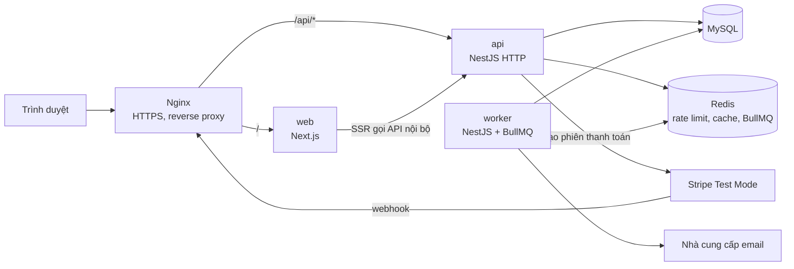
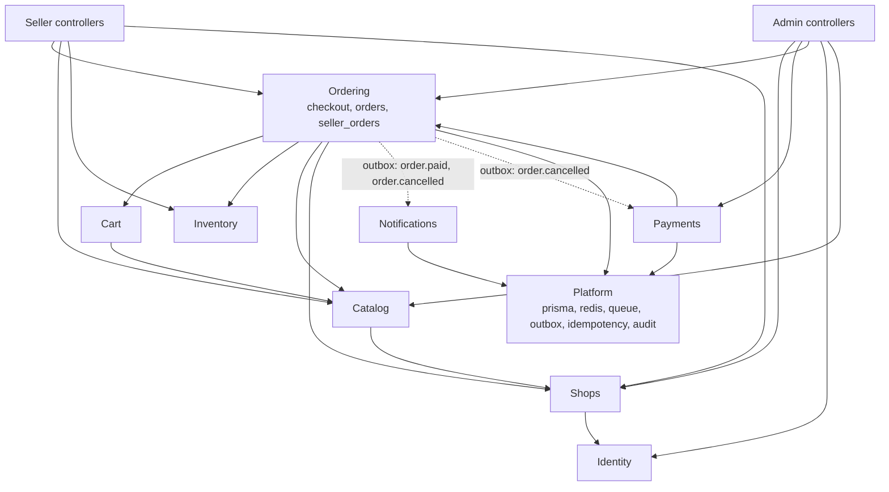
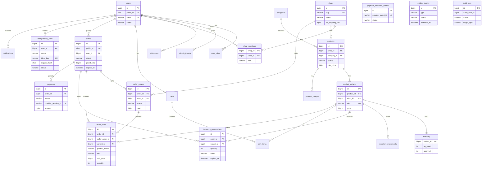
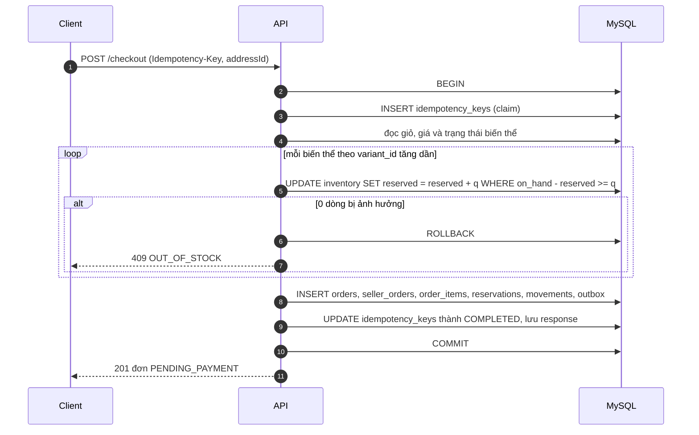
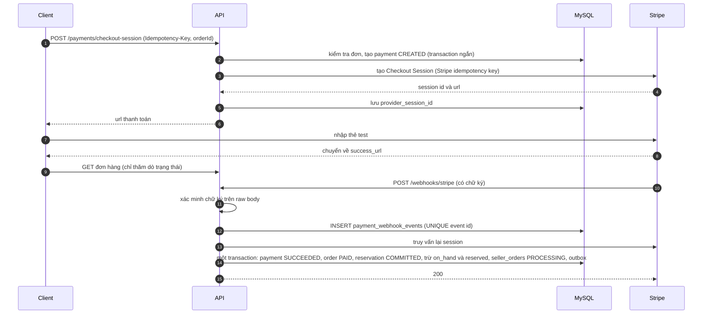
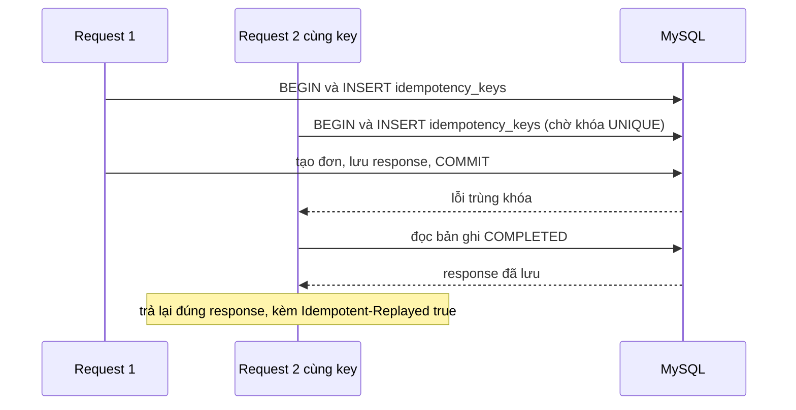
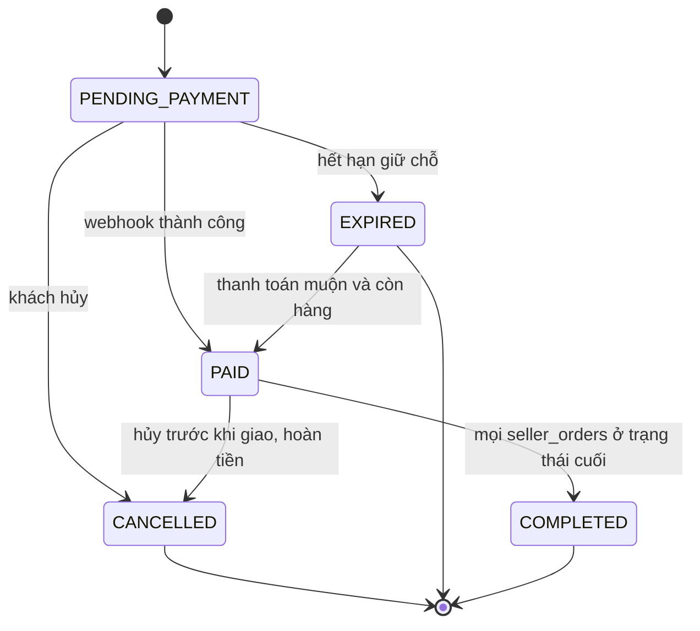
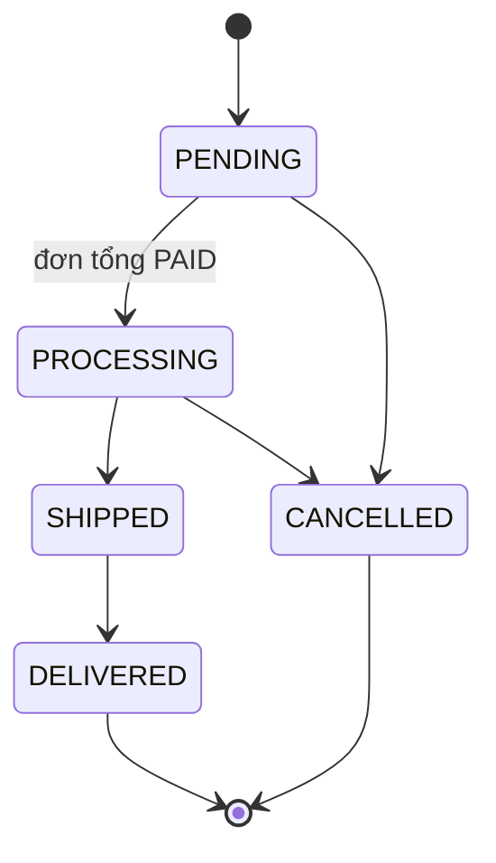

# CommerceOS — Đánh giá và thiết kế hoàn thiện

*Tài liệu phân tích kiến trúc cho dự án Fullstack portfolio · Phiên bản 1.0 · 25/10/2026*

> Quy ước của tài liệu: mọi con số về thời gian là ước lượng để lập kế hoạch, không phải số đo. Mọi con số hiệu năng chỉ được đưa vào CV sau khi bạn tự đo bằng k6 trên hệ thống thật của mình.

## Phần A — Đánh giá tổng quan

### A1. Tính khả thi trong 3–6 tháng

**Kết luận:** khả thi nếu cắt phạm vi; không khả thi nếu làm đủ mọi thứ trong đề xuất gốc với chất lượng gần production. Đề xuất gốc có 14 module, khoảng 30 bảng, 3 khu vực giao diện, thanh toán, hàng đợi, 4 loại kiểm thử, CI/CD và triển khai VPS.

Ước lượng (giả định một người, 20–30 giờ/tuần):

- Bản đầy đủ như đề xuất gốc: khoảng 7–9 tháng.
- Bản đã cắt gọt ở Phần I: khoảng 4–5 tháng, còn 3–4 tuần đệm cho lỗi phát sinh và tài liệu.

Nguyên tắc điều chỉnh: **chiều sâu thắng chiều rộng**. Một luồng đặt hàng → thanh toán → webhook chạy đúng dưới tải đồng thời có giá trị phỏng vấn hơn nhiều so với 14 module CRUD.

### A2. Điểm mạnh của ý tưởng

- Chọn đúng những bài toán mà người phỏng vấn senior hay hỏi: overselling, idempotency, webhook trùng/sai thứ tự, BOLA/IDOR, transaction.
- Modular monolith là lựa chọn đúng cho một người làm; có thể giải thích rõ khi nào nên tách.
- Toàn bộ TypeScript giúp giảm chi phí chuyển ngữ cảnh giữa frontend và backend.
- Chính đề xuất đã tự đặt nguyên tắc “không dùng công nghệ chỉ để làm đẹp CV” và “không bịa số liệu”. Đây là định hướng tốt.

### A3. Phần đang quá phức tạp hoặc chưa cần thiết

| Hạng mục | Vấn đề | Khuyến nghị |
| --- | --- | --- |
| 14 module | Nhiều module chỉ là CRUD, chi phí ranh giới lớn hơn lợi ích | Gộp còn 9 module domain + 1 lớp platform (mục B2) |
| Multi-vendor “thật” | Chia tiền cho seller, hoa hồng, payout, Stripe Connect là cả một dự án riêng | **Không làm.** Một payment cho một đơn tổng; `seller_orders` chỉ là phần xử lý/giao hàng của từng shop |
| Hoàn tiền/hủy từng phần | Kéo theo bù trừ tồn kho, mã giảm giá, đối soát | v1 chỉ hủy toàn bộ đơn trước khi giao + hoàn tiền toàn phần |
| Coupons | Stacking, điều kiện, phân bổ giảm giá về từng seller\_order | Hoãn sang giai đoạn sau; nếu làm thì 1 mã/đơn, giảm % hoặc số tiền cố định |
| Reviews, wishlist | CRUD thường, ít giá trị phỏng vấn | Hoãn |
| Analytics module | Không cần pipeline hay bảng riêng ở quy mô này | Vài truy vấn SQL tổng hợp + cache ngắn |
| Notifications | Push/SMS/đa kênh là thừa | Chỉ email + thông báo trong ứng dụng, qua hàng đợi |
| Zustand | Giỏ hàng và dữ liệu API là server state, đã có TanStack Query | Gần như không cần; chỉ dùng cho UI state cục bộ nếu thật sự cần |
| shop\_members nhiều vai trò | Phân quyền nhân viên shop làm phức tạp mọi truy vấn | v1 chỉ có OWNER; giữ bảng để mở rộng |
| Redis cho mọi thứ | Dễ lạm dụng | Chỉ dùng cho BullMQ, rate limit và vài cache có kiểm soát. **Không** lưu giỏ hàng hay idempotency ở Redis (lý do ở mục D5) |

### A4. Đánh giá bộ công nghệ

| Công nghệ | Quyết định | Ghi chú |
| --- | --- | --- |
| Next.js App Router | Giữ | Server Components cho trang công khai (SEO), Client Components cho phần tương tác |
| NestJS + REST | Giữ | Phù hợp tổ chức module, guard, interceptor, Swagger |
| Prisma | Giữ có điều kiện | Không khai báo được CHECK, partial index; không có `SELECT ... FOR UPDATE` native. Cần migration SQL viết tay và `$queryRaw` cho đoạn khóa dòng. Chấp nhận được, và đây là điểm có thể nói khi phỏng vấn |
| MySQL 8.x | Giữ được | PostgreSQL thuận lợi hơn một chút (partial unique index, CHECK, full-text không dấu qua `unaccent`). Nếu bạn đã quen MySQL thì **không đáng đổi**; thiết kế dưới đây dùng được cho cả hai và có ghi chú chỗ khác nhau |
| Redis + BullMQ | Giữ | Phạm vi nhỏ, có lý do rõ ràng (mục D6) |
| Stripe Test Mode | Giữ | Cần kiểm chứng sớm việc tài khoản của bạn có tạo được phiên thanh toán bằng VND hay không; nếu không, dùng USD cho demo (mục D3) |
| TanStack Query | Giữ | Dùng trong Client Components; Server Components gọi API trực tiếp |
| React Hook Form + Zod | Giữ | Zod chỉ để kiểm tra UX phía client; backend vẫn kiểm tra lại |
| DTO backend | `class-validator` + Swagger plugin | Idiomatic với NestJS. Frontend sinh type từ OpenAPI (`openapi-typescript`) thay vì chia sẻ schema Zod, để giữ ranh giới rõ |
| Jest + Supertest | Giữ | Integration test dùng MySQL và Redis thật qua Testcontainers hoặc Docker Compose |
| Playwright | Giữ, phạm vi nhỏ | 3–4 luồng chính, không cố bao phủ mọi màn hình |
| k6 | Giữ, phạm vi nhỏ | 4 kịch bản ở Phần F |
| Docker Compose, Nginx, GitHub Actions | Giữ | Không Kubernetes. Có thể thay Nginx bằng Caddy cho HTTPS tự động, nhưng Nginx + certbot là đủ và phổ biến |

### A5. Những vấn đề nghiêm trọng nhất cần giải quyết trước khi code

1. **Mô hình đa nhà bán và thanh toán.** Khách trả một lần cho giỏ hàng gồm nhiều shop. Phải chốt: `orders` (đơn tổng, có payment) và `seller_orders` (phần của từng shop, có trạng thái xử lý riêng). Không chia tiền cho seller trong v1.
2. **Bất biến của tồn kho.** `on_hand`, `reserved`, `available = on_hand - reserved` và vòng đời của reservation phải được định nghĩa bằng ràng buộc trong CSDL, không chỉ bằng code.
3. **Máy trạng thái** cho `orders`, `payments`, `seller_orders`, `inventory_reservations`: ai được chuyển trạng thái nào, do sự kiện nào.
4. **Tiền tệ.** Dùng số nguyên theo đơn vị nhỏ nhất (VND không có phần thập phân). Chốt quy tắc làm tròn khi giảm giá theo phần trăm.
5. **Mô hình phân quyền seller.** SELLER không phải vai trò toàn cục; quyền phát sinh từ `shop_members`. Mọi truy vấn của seller bắt buộc có điều kiện `shop_id` lấy từ bối cảnh đã xác thực.
6. **Nguồn sự thật của thanh toán** là webhook đã xác minh chữ ký (cộng với truy vấn lại Stripe khi đối soát), không phải redirect của trình duyệt.
7. **Nơi lưu idempotency key** và hành vi khi request đầu tiên còn đang chạy.
8. **Chi phí vận hành** của worker, Redis, backup và migration trên một VPS nhỏ.

## Phần B — Kiến trúc đề xuất

*Sơ đồ kiến trúc tổng thể bằng Mermaid nằm ở Phụ lục.*

### B1. Thành phần triển khai

Hệ thống chạy 6 container: `web` (Next.js), `api` (NestJS HTTP), `worker` (NestJS cho BullMQ), `mysql`, `redis`, `nginx`.

`api` và `worker` **dùng chung một codebase và một Docker image**, chỉ khác lệnh khởi động (`main.ts` và `worker.ts`). Lý do: job nặng hoặc job bị kẹt không làm tăng latency của API, nhưng vẫn là một khối triển khai duy nhất, không phải microservices. Nginx là điểm vào duy nhất, định tuyến `/api/*` tới `api`, còn lại tới `web`.

### B2. Module và trách nhiệm (đề xuất gộp)

| Module | Trách nhiệm | Sở hữu bảng | Giai đoạn |
| --- | --- | --- | --- |
| Platform (không phải domain) | Config, Prisma, Redis, queue, outbox relay, idempotency, audit, logging, health | `idempotency_keys`, `outbox_events`, `audit_logs` | 1–5 |
| Identity (Auth + Users) | Đăng ký, đăng nhập, token, hồ sơ, địa chỉ | `users`, `user_roles`, `refresh_tokens`, `addresses` | 2 |
| Shops | Cửa hàng, thành viên, kiểm duyệt shop | `shops`, `shop_members` | 2 |
| Catalog | Danh mục, sản phẩm, biến thể, ảnh, tìm kiếm | `categories`, `products`, `product_variants`, `product_images` | 2 |
| Inventory | Tồn kho, giữ chỗ, sổ biến động | `inventory`, `inventory_movements`, `inventory_reservations` | 3 |
| Cart | Giỏ hàng | `carts`, `cart_items` | 3 |
| Ordering (Checkout + Orders) | Quy trình checkout, đơn tổng, đơn theo seller, máy trạng thái | `orders`, `order_items`, `seller_orders` | 3 |
| Payments | Phiên thanh toán, webhook, đối soát | `payments`, `payment_webhook_events` | 4 |
| Notifications | Email và thông báo trong ứng dụng | `notifications` | 5 |
| Promotions, Reviews | Mã giảm giá, đánh giá | `coupons`, `coupon_redemptions`, `reviews` | Hoãn |

Hai điểm khác đề xuất gốc:

- **Admin không phải module domain.** Nó là lớp giao diện (controller) gọi các facade của module khác, kèm audit log. Nếu Admin sở hữu logic riêng, dữ liệu sẽ bị nhân đôi quy tắc.
- **Analytics không có bảng và không có pipeline** ở v1. Đó là các query chỉ đọc, đặt cạnh nơi dùng (dashboard seller, dashboard admin).

Checkout được đặt **trong** Ordering vì nó là một use case điều phối (Cart → Catalog → Inventory → Orders), không phải một miền dữ liệu độc lập.

### B3. Quy tắc phụ thuộc giữa các module

1. Mỗi module chỉ lộ ra ngoài qua `index.ts` gồm một **facade** (service công khai) và các kiểu dữ liệu. Không import repository, entity hay model Prisma của module khác.
2. **Chỉ module sở hữu bảng mới được ghi vào bảng đó.** Đọc chéo module đi qua facade. Ngoại lệ có chủ đích: truy vấn báo cáo chỉ đọc, ghi rõ trong tài liệu.
3. Hướng phụ thuộc: `Interface (seller/admin controllers)` → `Ordering` → `Cart, Inventory, Catalog` → `Shops, Identity` → `Platform`. Không đi ngược. Payments đứng cùng tầng với Ordering và phụ thuộc vào Ordering (để đánh dấu đơn đã trả); Ordering không import Payments, còn việc hoàn tiền khi hủy đơn nhận qua sự kiện outbox order.cancelled (xem sơ đồ P2).
4. Khi module cấp thấp cần “thông báo” cho cấp cao, dùng sự kiện (outbox), không import ngược.
5. Kiểm tra tự động bằng `eslint-plugin-boundaries` hoặc `dependency-cruiser` trong CI. Quy tắc chỉ có giá trị khi máy kiểm tra được.
6. Dùng `forwardRef` là dấu hiệu thiết kế sai; thay bằng đảo chiều phụ thuộc hoặc tách phần dùng chung xuống Platform.

### B4. Cấu trúc thư mục backend

```
apps/
  api/
    src/
      main.ts              # HTTP entrypoint
      worker.ts            # BullMQ entrypoint (cùng codebase)
      app.module.ts
      platform/            # config, prisma, redis, queue, outbox, idempotency, audit, logging, health
      modules/
        identity/
          identity.module.ts
          index.ts         # public API: facade + types
          api/             # controllers + DTO
          application/     # use cases / services
          domain/          # state machine, hàm thuần (dễ unit test)
          infra/           # repository, mapper (chỉ khi cần)
        shops/  catalog/  inventory/  cart/  ordering/  payments/  notifications/
      interface/
        seller/            # controllers /seller/* gọi facade
        admin/             # controllers /admin/*
    prisma/
      schema.prisma
      migrations/          # gồm migration SQL viết tay cho CHECK và index đặc biệt
  web/                     # Next.js
packages/
  api-types/               # type sinh từ OpenAPI
```

### B5. Controller, Service, Repository

- Controller chỉ làm: xác thực, kiểm tra DTO, gọi một use case, định dạng response. Không chứa nghiệp vụ.
- Service (use case) chứa nghiệp vụ và quản lý transaction.
- **Không áp Repository Pattern cho mọi module.** Quy tắc: module đơn giản (Shops, Catalog CRUD, Notifications) dùng Prisma trực tiếp trong service. Chỉ Inventory, Ordering và Payments có repository, vì ở đó có raw SQL, khóa dòng và truy vấn lặp lại cần gom về một chỗ để test.
- Logic thuần (tính tổng, máy trạng thái, tính tồn khả dụng) đặt trong `domain/` dưới dạng hàm không phụ thuộc framework để unit test nhanh.

### B6. Quản lý transaction

- Dùng `prisma.$transaction(async (tx) => ...)` (interactive transaction). Truyền `tx` tường minh qua tham số cho các hàm tham gia transaction trong luồng cốt lõi (checkout). Cách này dài dòng nhưng rõ ràng và dễ giải thích. Có thể thay bằng `nestjs-cls` + adapter transactional nếu code quá rối, nhưng không bắt buộc.
- Transaction **ngắn**: không gọi mạng ra ngoài (Stripe, email) bên trong transaction.
- Mức cô lập mặc định của MySQL InnoDB là REPEATABLE READ. Với tồn kho, không dựa vào mức cô lập mà dùng **cập nhật nguyên tử có điều kiện** (mục D2).
- Sự kiện cần gửi đi được ghi vào `outbox_events` **trong cùng transaction** với thay đổi nghiệp vụ.

### B7. Giao tiếp và xử lý sự kiện

Hai cơ chế, dùng đúng chỗ:

| Cơ chế | Dùng khi | Ví dụ |
| --- | --- | --- |
| Gọi đồng bộ qua facade | Cần kết quả ngay và cần nhất quán mạnh trong cùng transaction | Checkout gọi `InventoryFacade.reserve(tx, ...)` |
| Outbox → BullMQ | Tác dụng phụ có thể trễ vài giây nhưng **không được mất** | Gửi email xác nhận, tạo thông báo, xóa cache |

Outbox đơn giản: bảng `outbox_events` (id, type, payload, status, attempts, created\_at). Một relay trong `worker` quét theo lô (`SELECT ... FOR UPDATE SKIP LOCKED`, MySQL 8 hỗ trợ), đẩy vào BullMQ, rồi đánh dấu đã gửi. Job phải **idempotent** vì outbox đảm bảo “ít nhất một lần”, không phải “đúng một lần”.

Không dùng event bus nội bộ cho luồng cần nhất quán. Event-driven ở mọi nơi làm luồng đặt hàng khó theo dõi và khó test.

### B8. Tránh vòng phụ thuộc

- Giữ hướng phụ thuộc một chiều như B3.
- Dùng ID thay cho đối tượng: Cart lưu `variant_id`, không import entity của Catalog.
- Dữ liệu cần ở nhiều nơi (ví dụ kiểu tiền, mã lỗi) đặt ở Platform.
- Dùng sự kiện để đảo chiều khi cấp thấp cần biết về cấp cao.

### B9. Khi nào dùng hàng đợi thay vì xử lý đồng bộ

| Dùng hàng đợi khi | Giữ đồng bộ khi |
| --- | --- |
| Chậm hoặc phụ thuộc dịch vụ ngoài (email, tạo báo cáo) | Quyết định kết quả của request (kiểm tra tồn, tính giá) |
| Người dùng không cần chờ kết quả | Cần trả lỗi ngay cho người dùng |
| Cần thử lại khi lỗi tạm thời | Rất nhanh và không có tác dụng phụ ngoài |
| Có tác vụ định kỳ (nhả giữ chỗ hết hạn, đối soát) |  |

### B10. Dấu hiệu thực tế cần cân nhắc tách module thành dịch vụ riêng

- Một module cần **scale độc lập** và có số đo chứng minh (ví dụ tìm kiếm chiếm phần lớn CPU).
- Nhịp phát hành khác hẳn, nhiều lần sửa module này làm kẹt cả hệ thống.
- Cần công nghệ khác hẳn (ví dụ công cụ tìm kiếm chuyên dụng).
- Nhiều nhóm làm việc và dẫm chân nhau trên cùng module.
- Yêu cầu cách ly sự cố hoặc tuân thủ (ví dụ cô lập dữ liệu thanh toán).

Với một người làm và một VPS, **không có dấu hiệu nào trong số này**. Có thể nói điều đó trực tiếp khi phỏng vấn, kèm nhận định ứng viên đầu tiên nếu có là Catalog search và Notifications.

### B11. Tóm tắt quyết định kiến trúc

| Quyết định | Lý do | Đánh đổi |
| --- | --- | --- |
| Modular monolith, 9 module | Một người, một VPS, cần nhất quán giao dịch | Ranh giới chỉ giữ được bằng kỷ luật và kiểm tra tự động |
| `api` và `worker` tách process, chung codebase | Cách ly tải nền khỏi API | Thêm một container |
| Nhất quán qua transaction, bất đồng bộ qua outbox | Không mất sự kiện | Phải viết job idempotent |
| Idempotency và tồn kho dựa trên CSDL, không dựa Redis | Redis có thể mất dữ liệu, CSDL là nguồn sự thật | Chậm hơn Redis một chút, chấp nhận được |
| Repository có chọn lọc | Tránh lớp bọc vô ích | Mức độ đồng nhất mã nguồn thấp hơn |

## Phần C — Thiết kế cơ sở dữ liệu

*ERD bằng Mermaid nằm ở Phụ lục. Phần này mô tả cột, ràng buộc và các quyết định.*

### C1. Quy ước chung

- **Khóa:** `id BIGINT UNSIGNED AUTO_INCREMENT` dùng nội bộ để join; thêm `public_id CHAR(26)` (ULID, UNIQUE) cho API. ID tuần tự lộ số lượng đơn và dễ bị dò. Lưu ý: ID khó đoán chỉ giảm rủi ro, **không thay thế** việc kiểm tra quyền sở hữu.
- **Tiền:** `BIGINT` theo đơn vị nhỏ nhất kèm `currency CHAR(3)`. VND không có phần thập phân nên 1 đơn vị là 1 đồng. Tuyệt đối không dùng `FLOAT/DOUBLE`. Prisma ánh xạ sang `BigInt`; API trả số nguyên và có giới hạn trên cho mỗi dòng để không vượt 2^53.
- **Làm tròn:** mọi phép giảm giá theo phần trăm làm tròn xuống tới đồng, tính một lần trên tổng. Quy tắc này phải nằm trong một hàm thuần có unit test.
- **Thời gian:** `DATETIME(3)` lưu UTC; frontend đổi múi giờ khi hiển thị.
- **Chuỗi:** `utf8mb4`. Email chuẩn hóa chữ thường trước khi lưu.
- **Trạng thái:** lưu `VARCHAR` kèm `CHECK` (hoặc enum của Prisma); quy tắc chuyển trạng thái nằm ở `domain/`, không nằm trong CSDL.
- **Khóa lạc quan:** cột `version INT` ở những bảng có nhiều tác nhân sửa đồng thời (`orders`, `payments`, `seller_orders`, `products`).

### C2. Nhóm tài khoản và phân quyền

**users** — `id, public_id, email VARCHAR(255), password_hash VARCHAR(255)` (argon2id), `full_name, phone NULL, status` (ACTIVE | SUSPENDED | DELETED), `email_verified_at NULL, created_at, updated_at, deleted_at NULL`.

- UNIQUE(`email`). Xóa mềm; khi người dùng yêu cầu xóa thì ẩn danh hóa email, số điện thoại và giữ lại `id` để đơn hàng không mất tham chiếu.

**user\_roles** — `user_id, role` (CUSTOMER | ADMIN). PK(`user_id, role`).

- **Không có role SELLER ở đây.** Quyền seller đến từ `shop_members`. Đây là thay đổi quan trọng nhất của nhóm này, vì vai trò toàn cục khiến việc kiểm tra theo shop dễ bị bỏ sót.

**refresh\_tokens** — `id, user_id, family_id CHAR(26), token_hash CHAR(64), expires_at, revoked_at NULL, replaced_by_id NULL, user_agent, ip, created_at`.

- UNIQUE(`token_hash`); INDEX(`user_id`), INDEX(`family_id`), INDEX(`expires_at`) để dọn rác.
- Chỉ lưu **băm SHA-256** của token ngẫu nhiên 256 bit, không lưu token gốc. Xoay vòng token mỗi lần refresh; nếu một token đã bị thu hồi mà bị dùng lại thì thu hồi cả `family_id` (phát hiện bị đánh cắp). Xóa cứng bản ghi quá hạn sau một khoảng thời gian.

**addresses** *(thiếu trong thiết kế gốc, cần thêm)* — `id, user_id, recipient_name, phone, line1, ward, district, province, is_default`. INDEX(`user_id`). Có thể xóa cứng vì đơn hàng đã lưu snapshot địa chỉ.

### C3. Nhóm cửa hàng

**shops** — `id, public_id, name, slug, description, logo_key, status` (PENDING | ACTIVE | SUSPENDED | CLOSED), `reviewed_by NULL, reviewed_at NULL, suspension_reason NULL`.

- UNIQUE(`slug`); INDEX(`status`). Không xóa; chuyển sang CLOSED.
- Shop chỉ hiện trên storefront khi `ACTIVE`. Shop bị SUSPENDED: sản phẩm bị ẩn, nhưng đơn đã thanh toán vẫn phải được xử lý hoặc hoàn tiền (quy tắc này cần ghi vào Phần K).

**shop\_members** — `shop_id, user_id, role` (OWNER | STAFF). PK(`shop_id, user_id`); INDEX(`user_id`).

- Mỗi shop đúng một OWNER. MySQL không có partial unique index, nên dùng cột sinh: `owner_marker = IF(role='OWNER', shop_id, NULL)` với UNIQUE (MySQL cho phép nhiều NULL). PostgreSQL thì dùng partial unique index.
- v1: chỉ OWNER, nhưng giữ bảng để mở rộng.

### C4. Nhóm danh mục và sản phẩm

**categories** — `id, parent_id NULL, name, slug, position, is_active`. UNIQUE(`slug`). Danh sách kề, tối đa 3 cấp (kiểm tra ở service). Chỉ admin sửa, không xóa nếu còn sản phẩm; ẩn bằng `is_active`. Cả cây nhỏ nên cache được.

**products** — `id, public_id, shop_id, category_id, name VARCHAR(200), slug, description TEXT, search_text TEXT, status` (DRAFT | ACTIVE | HIDDEN | ARCHIVED), `min_price BIGINT, version, created_at, updated_at, deleted_at NULL`.

- UNIQUE(`shop_id, slug`); **UNIQUE(`id, shop_id`)** (để bảng biến thể tham chiếu bằng khóa kép, xem dưới).
- INDEX(`category_id, status, id`) cho trang danh mục, INDEX(`shop_id, status, id`) cho shop, FULLTEXT(`search_text`).
- `search_text` là chuỗi **đã bỏ dấu và chuẩn hóa** (kể cả đ→d), vì collation không xử lý đầy đủ tiếng Việt. Tìm kiếm v1 dùng cột này; chỉ cân nhắc Meilisearch hoặc OpenSearch nếu có số đo chứng minh cần.
- `min_price` là dữ liệu phi chuẩn hóa để lọc/sắp xếp theo giá, cập nhật trong cùng transaction khi sửa giá biến thể.
- Xóa: chuyển ARCHIVED hoặc xóa mềm. Không xóa cứng sản phẩm đã từng được bán.

**product\_variants** — `id, public_id, product_id, shop_id, sku VARCHAR(64), option_values JSON, option_hash CHAR(64), price BIGINT, compare_at_price BIGINT NULL, currency, status` (ACTIVE | INACTIVE), `deleted_at NULL`.

- **Khóa ngoại kép (`product_id, shop_id`) → `products(id, shop_id)`**: CSDL tự bảo đảm biến thể luôn cùng shop với sản phẩm. Đây là một lớp phòng thủ chống dữ liệu chéo shop ở tầng dữ liệu.
- UNIQUE(`shop_id, sku`); UNIQUE(`product_id, option_hash`).
- CHECK(`price >= 0`); CHECK(`compare_at_price IS NULL OR compare_at_price >= price`).
- Mọi sản phẩm có ít nhất một biến thể (biến thể mặc định) để giỏ hàng, tồn kho và đơn hàng luôn tham chiếu `variant_id`. Quy tắc này kiểm tra ở service và có test.

**product\_images** — `id, product_id, variant_id NULL, storage_key, alt, position, is_primary`. INDEX(`product_id, position`). DB chỉ lưu khóa tệp; tệp nằm ở volume hoặc object storage tương thích S3. Kiểm tra loại MIME, kích thước và xử lý tên tệp khi upload.

### C5. Nhóm tồn kho

**Quyết định: tồn kho quản lý theo biến thể (SKU), không theo sản phẩm.** Giá và tồn kho khác nhau giữa các biến thể (size M còn hàng, size L hết).

**inventory** — `variant_id` (PK), `shop_id, on_hand INT, reserved INT, low_stock_threshold INT NULL, version, updated_at`.

- CHECK(`on_hand >= 0`), CHECK(`reserved >= 0`), CHECK(`reserved <= on_hand`). Đây là rào chắn cuối cùng chống overselling: dù code sai, CSDL vẫn từ chối.
- `available = on_hand - reserved` **tính khi truy vấn, không lưu** để không bao giờ lệch.

**Định nghĩa:**

- `on_hand`: số lượng thực tế còn thuộc quyền bán của shop (chưa trừ cho đơn chưa chốt).
- `reserved`: số lượng đang giữ chỗ cho các đơn đang chờ thanh toán.
- Khi thanh toán thành công: `on_hand -= q` và `reserved -= q` (hàng chính thức thuộc về đơn). Khi hết hạn hoặc thanh toán thất bại: chỉ `reserved -= q`.

**inventory\_movements** *(sổ cái, chỉ thêm)* — `id, variant_id, shop_id, type` (RESTOCK | ADJUST | RESERVE | RELEASE | COMMIT | RETURN), `on_hand_delta, reserved_delta, reason, ref_type, ref_id, actor_user_id NULL, created_at`.

- Không UPDATE/DELETE. UNIQUE(`variant_id, ref_type, ref_id, type`) để job retry không ghi trùng. INDEX(`variant_id, created_at`).
- Bất biến kiểm tra được: `on_hand = SUM(on_hand_delta)` và `reserved = SUM(reserved_delta)`. Một job đối soát hằng đêm so sánh hai bên và báo khi lệch.

**inventory\_reservations** — `id, order_id, variant_id, quantity INT, status` (ACTIVE | COMMITTED | RELEASED | EXPIRED), `expires_at, created_at, updated_at`.

- UNIQUE(`order_id, variant_id`); CHECK(`quantity > 0`); INDEX(`status, expires_at`) cho job nhả chỗ hết hạn.
- Bất biến: `inventory.reserved = SUM(quantity)` của các reservation ACTIVE.

### C6. Nhóm giỏ hàng và đơn hàng

**carts** — `id, user_id, updated_at`; UNIQUE(`user_id`). v1 yêu cầu đăng nhập; giỏ khách vãng lai hoãn lại.

**cart\_items** — PK(`cart_id, variant_id`), `quantity INT` CHECK(1–99), `price_at_add BIGINT`. Giá trong giỏ **không phải nguồn sự thật**: chỉ dùng để cảnh báo “giá đã thay đổi”. Giá thật luôn lấy lại từ Catalog khi checkout. Xóa cứng.

**orders** *(đơn tổng của khách)* — `id, public_id, order_number VARCHAR(20), user_id, status, subtotal, discount_total, shipping_total, grand_total BIGINT, currency, shipping_address JSON, contact_email, contact_phone, expires_at, placed_at, paid_at NULL, cancelled_at NULL, version`.

- `status`: PENDING\_PAYMENT | PAID | CANCELLED | EXPIRED | COMPLETED.
- UNIQUE(`order_number`); CHECK(`grand_total = subtotal - discount_total + shipping_total`); INDEX(`user_id, created_at`), INDEX(`status, expires_at`).
- Không xóa. Địa chỉ và liên hệ là **snapshot**: sửa địa chỉ sau này không làm đổi đơn cũ.

**seller\_orders** *(phần của từng shop trong đơn tổng)* — `id, public_id, order_id, shop_id, status, subtotal, shipping_fee, total, carrier NULL, tracking_code NULL, shipped_at, delivered_at, cancelled_at, version`.

- `status`: PENDING (chưa thanh toán, seller chưa thấy) → PROCESSING → SHIPPED → DELIVERED; hoặc CANCELLED.
- UNIQUE(`order_id, shop_id`); INDEX(`shop_id, status, created_at`) — truy vấn chính của dashboard seller.
- **Seller chỉ đọc `seller_orders` của shop mình** và chỉ nhận các trường cần để giao hàng (tên, số điện thoại, địa chỉ nhận), không nhận email hay lịch sử mua hàng của khách.

**order\_items** — `id, order_id, seller_order_id, shop_id, product_id, variant_id, product_name, variant_label, sku, image_key, unit_price BIGINT, quantity INT, line_total BIGINT`.

- CHECK(`quantity > 0`); CHECK(`line_total = unit_price * quantity`); INDEX(`order_id`), INDEX(`seller_order_id`), INDEX(`variant_id`).
- FK tới sản phẩm/biến thể dùng `ON DELETE RESTRICT`; thông tin hiển thị lấy từ **snapshot**, không join lại Catalog.

### C7. Nhóm thanh toán và chống xử lý trùng

**payments** — `id, public_id, order_id, provider` (STRIPE), `status` (CREATED | SUCCEEDED | FAILED | CANCELLED | REFUNDED), `provider_session_id, provider_payment_intent_id NULL, amount BIGINT, currency, failure_code NULL, refunded_at NULL, version, created_at, updated_at`.

- UNIQUE(`provider_session_id`); UNIQUE(`provider_payment_intent_id`); INDEX(`order_id`).
- Một đơn có thể có nhiều payment (thử lại), nhưng **tối đa một payment SUCCEEDED**: dùng cột sinh `succeeded_order = IF(status='SUCCEEDED', order_id, NULL)` với UNIQUE. Tương tự có thể giới hạn một payment đang hoạt động trên mỗi đơn.
- Số tiền của payment phải bằng `orders.grand_total` tại thời điểm tạo, và được đối chiếu lại khi nhận webhook.

**payment\_webhook\_events** — `id, provider, provider_event_id VARCHAR(64), type, payload JSON, provider_created_at, status` (RECEIVED | PROCESSED | FAILED | IGNORED), `attempts, error NULL, received_at, processed_at NULL`.

- UNIQUE(`provider, provider_event_id`) là cơ chế chống xử lý trùng ở tầng dữ liệu. INDEX(`status, received_at`).
- Có chính sách lưu giữ (ví dụ 30–90 ngày) và hạn chế lưu dữ liệu cá nhân trong `payload`.

**idempotency\_keys** — `id, user_id, scope VARCHAR(40), idem_key VARCHAR(64), request_hash CHAR(64), status` (IN\_PROGRESS | COMPLETED), `response_status SMALLINT NULL, response_body JSON NULL, resource_type NULL, resource_id NULL, locked_until, expires_at, created_at`.

- UNIQUE(`user_id, scope, idem_key`); INDEX(`expires_at`). Chi tiết cơ chế ở mục D5.

### C8. Nhóm chức năng mở rộng

| Bảng | Trạng thái | Ghi chú thiết kế khi làm |
| --- | --- | --- |
| `notifications` | Nên có | `user_id, type, title, body, data JSON, read_at, created_at`; INDEX(`user_id, read_at, created_at`) |
| `audit_logs` | Bắt buộc có | Chỉ thêm. `actor_user_id, actor_role, action, target_type, target_id, shop_id NULL, before_json, after_json, ip, request_id, created_at`. Không ghi mật khẩu, token hay dữ liệu cá nhân thừa. INDEX(`target_type, target_id`), INDEX(`actor_user_id, created_at`) |
| `outbox_events` | Nên có | `aggregate_type, aggregate_id, type, payload JSON, status, attempts, available_at, created_at, sent_at`; INDEX(`status, available_at, id`) |
| `coupons`, `coupon_redemptions` | Hoãn | Khi làm: UNIQUE(`coupon_id, order_id`); tăng `used_count` bằng cập nhật nguyên tử có điều kiện |
| `reviews` | Hoãn | UNIQUE(`user_id, order_item_id`); khóa ngoại tới `order_items` chính là bằng chứng đã mua |
| `wishlists`, `wishlist_items` | Hoãn | **Bỏ bảng `wishlists`**: mỗi người một danh sách nên chỉ cần `wishlist_items(user_id, product_id)` |

### C9. Những dữ liệu phải lưu dạng snapshot

- Trong `order_items`: tên sản phẩm, nhãn biến thể, SKU, đơn giá, ảnh, `shop_id`.
- Trong `orders`: địa chỉ giao hàng, email và số điện thoại liên hệ, các khoản tiền (subtotal, giảm giá, phí vận chuyển, tổng).
- Trong `payments`: số tiền và loại tiền tại thời điểm tạo.
- Khi làm coupon: mã, loại, giá trị giảm tại thời điểm áp dụng.

### C10. Ràng buộc ứng dụng không thể chỉ dựa vào frontend

Những điều sau **phải do backend và CSDL bảo đảm**:

1. Giá, tổng tiền, phí vận chuyển và giảm giá luôn tính lại ở server.
2. `on_hand >= 0` và `reserved <= on_hand` (CHECK).
3. Mỗi variant, SKU, slug, email, `provider_event_id` là duy nhất (UNIQUE).
4. Biến thể và tồn kho cùng `shop_id` với sản phẩm (khóa kép).
5. Tối đa một payment thành công cho mỗi đơn.
6. Chuyển trạng thái đơn chỉ theo đường hợp lệ (cập nhật có điều kiện `WHERE status = ?`).
7. Seller chỉ thấy và sửa dữ liệu có `shop_id` thuộc `shop_members` của mình (kiểm tra ở tầng service, có test BOLA).
8. Chỉ người đã mua mới được đánh giá (khi làm reviews).

### C11. Phi chuẩn hóa có chủ đích và cách kiểm soát

| Dữ liệu phi chuẩn hóa | Lý do | Cách kiểm soát |
| --- | --- | --- |
| `products.min_price` | Lọc và sắp xếp theo giá không cần join | Cập nhật trong cùng transaction; có test |
| `product_variants.shop_id`, `inventory.shop_id` | Kiểm tra quyền và index theo shop | Khóa ngoại kép |
| `orders.*_total`, `seller_orders.total` | Truy vấn nhanh, và là snapshot | CHECK cộng đúng; test tổng seller\_orders = tổng orders |
| `inventory.on_hand/reserved` | Cập nhật nguyên tử | Sổ cái `inventory_movements` và job đối soát |

### C12. Thay đổi so với thiết kế gốc

1. **Thêm** `addresses`.
2. **Bỏ** `wishlists` (giữ `wishlist_items`).
3. `user_roles` **không có SELLER**; quyền seller đến từ `shop_members`.
4. `inventory_reservations` gắn với `order_id` (đơn được tạo trước khi thanh toán); thêm `expires_at` cho cả `orders` và reservation.
5. `order_items` thêm `seller_order_id`, `shop_id` và các cột snapshot.
6. `product_variants` và `inventory` có `shop_id` kèm khóa ngoại kép.
7. `payments`: ràng buộc một payment SUCCEEDED trên mỗi đơn.
8. `idempotency_keys` có `scope`, `request_hash`, `status` và `locked_until`.
9. Các bảng `coupons`, `coupon_redemptions`, `reviews`, `wishlist_items` **đưa sang giai đoạn sau**; `notifications` ở mức tối giản.
10. Thêm các CHECK/UNIQUE đã nêu bằng **migration SQL viết tay**, vì Prisma schema không khai báo được chúng.

## Phần D — Thiết kế nghiệp vụ

*Các sơ đồ tuần tự tương ứng nằm ở Phụ lục.*

### D1. Máy trạng thái

| Thực thể | Chuyển trạng thái hợp lệ | Tác nhân |
| --- | --- | --- |
| `orders` | PENDING\_PAYMENT → PAID | Webhook thanh toán thành công |
|  | PENDING\_PAYMENT → EXPIRED | Job hết hạn giữ chỗ (thanh toán đến muộn mà còn hàng thì EXPIRED → PAID, xem D3) |
|  | PENDING\_PAYMENT → CANCELLED | Khách hủy |
|  | PAID → CANCELLED | Hủy trước khi giao, kèm hoàn tiền |
|  | PAID → COMPLETED | Khi mọi `seller_orders` ở trạng thái cuối |
| `seller_orders` | PENDING → PROCESSING | Khi đơn tổng chuyển PAID |
|  | PROCESSING → SHIPPED → DELIVERED | Seller cập nhật |
|  | PENDING / PROCESSING → CANCELLED | Hủy đơn |
| `payments` | CREATED → SUCCEEDED / FAILED / CANCELLED | Webhook hoặc đối soát |
|  | SUCCEEDED → REFUNDED | Hoàn tiền |
| `inventory_reservations` | ACTIVE → COMMITTED / RELEASED / EXPIRED | Thanh toán, hủy, hết hạn |

**Quy tắc áp dụng cho mọi chuyển trạng thái:** viết dưới dạng cập nhật có điều kiện `UPDATE ... SET status = :new WHERE id = :id AND status IN (:allowed)` rồi kiểm tra số dòng bị ảnh hưởng bằng 1. Không đọc trạng thái lên rồi ghi lại. Cách này an toàn khi hai tác nhân (webhook và job hết hạn) cùng tác động lên một đơn: chỉ một bên thắng.

### D2. Đặt hàng và giữ chỗ tồn kho

**So sánh các phương án chống overselling**

| Phương án | Cách hoạt động | Ưu | Nhược |
| --- | --- | --- | --- |
| Transaction thông thường (đọc rồi ghi) | Đọc tồn, kiểm tra trong code, rồi ghi | Dễ viết | **Sai.** Hai request cùng đọc “còn 1” rồi cùng ghi; transaction không tự ngăn điều này |
| Khóa dòng bi quan (`SELECT ... FOR UPDATE`) | Khóa dòng tồn kho, kiểm tra, ghi | Đúng và dễ hiểu | Giữ khóa lâu hơn; nguy cơ deadlock nếu khóa nhiều dòng theo thứ tự khác nhau; Prisma cần `$queryRaw` |
| **Cập nhật nguyên tử có điều kiện** | `UPDATE inventory SET reserved = reserved + :q WHERE variant_id = :id AND on_hand - reserved >= :q`; thành công khi bị ảnh hưởng 1 dòng | Một câu lệnh, khóa dòng rất ngắn, không cần đọc trước, kết hợp CHECK | Phải xử lý trường hợp 0 dòng (hết hàng) |
| Khóa lạc quan (`version`) | Đọc kèm version, ghi `WHERE version = :v`, thử lại khi xung đột | Không giữ khóa | Khi nhiều người tranh một SKU còn 1 cái thì phần lớn thử lại thất bại, tốn tài nguyên; hợp với việc seller sửa sản phẩm, không hợp với tranh tồn kho |
| Trừ tồn trong Redis | Giảm bộ đếm Redis | Nhanh | Hai nguồn sự thật, lệch khi Redis mất hoặc khi bước sau thất bại. **Không dùng** |

**Đề xuất:** cập nhật nguyên tử có điều kiện, chạy trong transaction ngắn, khóa theo thứ tự `variant_id` tăng dần để tránh deadlock, và CHECK trong CSDL làm lưới an toàn. Khóa lạc quan chỉ dùng cho `products` khi seller sửa.

**Luồng tạo đơn (`POST /checkout`)**

Client chỉ gửi `addressId` (và tùy chọn mã giảm giá sau này). **Không gửi giá, tên hay số lượng**; server đọc giỏ từ CSDL. Header `Idempotency-Key` là bắt buộc.

1. Claim idempotency key (D5, mẫu A).
2. Mở transaction ngắn.
3. Đọc giỏ, nối với biến thể, sản phẩm, shop; từ chối nếu sản phẩm, biến thể hoặc shop không còn ACTIVE.
4. Tính giá và tổng tiền từ dữ liệu CSDL bằng hàm thuần.
5. Sắp xếp theo `variant_id`; với mỗi dòng chạy cập nhật nguyên tử `reserved += q`. Nếu một dòng trả 0 dòng thì rollback và trả `409 OUT_OF_STOCK` kèm danh sách dòng bị thiếu.
6. Tạo `orders` (PENDING\_PAYMENT, `expires_at`), `seller_orders` theo từng shop, `order_items` với snapshot, `inventory_reservations` (ACTIVE), `inventory_movements` (RESERVE).
7. Lưu kết quả vào `idempotency_keys`, ghi `outbox_events` nếu cần, commit.
8. Trả đơn ở trạng thái PENDING\_PAYMENT. **Chưa xóa giỏ**; giỏ chỉ được dọn khi đơn chuyển PAID, để khách hủy hoặc hết hạn vẫn quay lại giỏ.

### D3. Giữ chỗ, chốt và giải phóng tồn kho

- **Giữ chỗ:** ở bước tạo đơn. Thời gian giữ ban đầu đề xuất 30 phút. Lưu ý Stripe Checkout Session có thời hạn tối thiểu (theo tài liệu hiện hành là 30 phút, cần kiểm chứng khi làm) nên không đặt TTL giữ chỗ ngắn hơn mức này.
- **Chốt (khi thanh toán thành công):** một transaction duy nhất: `orders` → PAID, `payments` → SUCCEEDED, `inventory_reservations` → COMMITTED, `on_hand -= q` và `reserved -= q`, ghi movement COMMIT, `seller_orders` → PROCESSING, dọn các dòng giỏ liên quan, ghi outbox `order.paid`.
- **Giải phóng:** job lặp mỗi phút quét `orders` PENDING\_PAYMENT đã quá `expires_at` theo lô nhỏ (`FOR UPDATE SKIP LOCKED`). Mỗi đơn xử lý trong transaction riêng: `orders` → EXPIRED, reservation → EXPIRED, `reserved -= q`, movement RELEASE. Sau transaction, gọi Stripe để hết hạn phiên thanh toán (làm theo kiểu cố gắng hết sức và có thử lại, không nằm trong transaction).
- **Thanh toán thất bại:** giữ chỗ đến hết hạn để khách thử lại; nếu khách chủ động hủy thì giải phóng ngay.
- **Thanh toán đến muộn** (đơn đã EXPIRED nhưng Stripe báo đã trả): thử giữ chỗ lại bằng cập nhật nguyên tử. Còn hàng thì chuyển đơn sang PAID. Hết hàng thì đánh dấu payment cần hoàn tiền, tự động hoàn tiền qua Stripe, thông báo cho khách và ghi audit. **Tiền không được phép “mất”.**

### D4. Thanh toán với Stripe Test Mode

**Luồng tạo phiên thanh toán** (`POST /payments/checkout-session`, có `Idempotency-Key`):

1. Transaction ngắn: kiểm tra đơn thuộc về user, còn PENDING\_PAYMENT và chưa hết hạn; tạo hoặc dùng lại `payments` ở trạng thái CREATED với `amount = orders.grand_total`.
2. **Ngoài transaction**: gọi Stripe tạo Checkout Session. Truyền Stripe idempotency key suy ra từ `payments.public_id`, `client_reference_id = orders.public_id`, `metadata` chứa ID đơn và payment, `success_url` và `cancel_url`.
3. Transaction ngắn: lưu `provider_session_id` vào payment, trả URL cho client.
4. Nếu bước 2 timeout: thử lại với cùng Stripe idempotency key, Stripe trả cùng phiên. Nếu quá giới hạn thử lại, trả `502` với `retryable: true` và **không** đổi trạng thái đơn.

**Tiền tệ:** hãy kiểm tra sớm xem tài khoản Stripe của bạn có tạo được phiên bằng VND hay không (cần thử thực tế). Nếu không, dùng USD cho môi trường demo, chuyển đổi bằng một tỉ giá cố định ghi rõ trong tài liệu.

**Quan hệ:** một `orders` có 0..N `payments` (các lần thử); mỗi `payments` có đúng một phiên Stripe; tối đa một payment SUCCEEDED trên mỗi đơn (ràng buộc CSDL ở C7).

**Xử lý webhook** (`POST /webhooks/stripe`):

1. Bật `rawBody` cho route này; **xác minh chữ ký** bằng `stripe.webhooks.constructEvent` với secret và ngưỡng thời gian. Sai chữ ký → `400`, không xử lý.
2. `INSERT` vào `payment_webhook_events`. Trùng `provider_event_id` thì: đã PROCESSED → trả `200` ngay; chưa xong → xử lý lại.
3. **Không tin payload một cách mù quáng.** Handler truy vấn lại phiên từ Stripe API để lấy trạng thái hiện tại, rồi đối chiếu: `payment_status` đã trả, `amount_total` và `currency` khớp với `payments`, `client_reference_id` khớp đơn.
4. Áp dụng chuyển trạng thái bằng cập nhật có điều kiện. Sự kiện không còn hợp lệ với trạng thái hiện tại (ví dụ `expired` đến sau `completed`) được đánh dấu IGNORED và ghi log.
5. Thành công → `200`. Lỗi tạm thời → ghi FAILED, trả `5xx` để Stripe gửi lại; job quét lại các sự kiện FAILED.

Sự kiện tối thiểu cần xử lý: `checkout.session.completed`, `checkout.session.expired`, `charge.refunded`.

**Webhook sai thứ tự:** không dựa vào thứ tự đến. Mỗi handler dựa trên trạng thái hiện tại và trạng thái thật lấy từ Stripe, nên xử lý lại hoặc xử lý muộn đều cho kết quả như nhau.

**Khách trả tiền nhưng trình duyệt không nhận được phản hồi:** trang `success_url` chỉ hiển thị “đang xác nhận thanh toán” và thăm dò `GET /orders/:id` (hoặc SSE) cho tới khi đơn PAID. Trang này **không** đổi trạng thái. Có thêm `POST /payments/:id/sync` (giới hạn tốc độ) để chủ động hỏi Stripe.

**Đối soát:**

- Job mỗi 5–10 phút: payment CREATED đã có phiên nhưng quá lâu chưa có kết quả → truy vấn Stripe và áp dụng cùng handler.
- Job hằng đêm: so khớp các đơn PAID trong 24 giờ với thanh toán thành công ở Stripe, báo lệch.
- Trang admin “Thanh toán cần xử lý” cho trường hợp còn lệch; mọi thao tác thủ công ghi `audit_logs`.

### D5. Idempotency

**Phía client:** sinh UUIDv4 khi bắt đầu một *ý định* đặt hàng (mở màn hình xác nhận), lưu trong `sessionStorage`, dùng lại cho mọi lần bấm cho tới khi có kết quả cuối. Giỏ hàng đổi thì sinh key mới. Gửi qua header `Idempotency-Key`. Vô hiệu hóa nút bấm chỉ là cải thiện trải nghiệm, không phải cơ chế bảo vệ.

**Phía server:** lưu trong bảng `idempotency_keys` của MySQL, **không phải Redis**. Lý do: bản ghi claim và kết quả phải cùng nguyên tử với việc tạo đơn; Redis có thể mất dữ liệu khi khởi động lại và khi đó đơn sẽ bị tạo trùng. TTL 24 giờ, job dọn theo `expires_at`.

**Phạm vi:** `(user_id, scope, key)`. Hai người dùng dùng cùng chuỗi không ảnh hưởng nhau.

**Phát hiện payload khác:** lưu `request_hash` = SHA-256 của method + path + body chuẩn hóa. Cùng key nhưng hash khác → `422 IDEMPOTENCY_KEY_REUSED`.

**Mẫu A — thao tác chỉ dùng CSDL (tạo đơn):** `INSERT` bản ghi claim nằm **trong cùng transaction** nghiệp vụ.

- Request thứ hai cùng key bị khóa chờ ở UNIQUE index cho tới khi request đầu commit, sau đó nhận lỗi trùng khóa, đọc bản ghi COMPLETED và **trả lại đúng response đã lưu** (kèm header `Idempotent-Replayed: true`).
- Nếu request đầu rollback thì claim cũng biến mất, request sau tự xử lý như request mới.

**Mẫu B — thao tác có gọi dịch vụ ngoài (khởi tạo thanh toán):** vì không giữ transaction trong lúc gọi Stripe, claim phải được commit trước.

1. Insert claim IN\_PROGRESS với `locked_until = now + 30s`.
2. Thực hiện thao tác, truyền Stripe idempotency key suy ra từ key của mình.
3. Cập nhật claim sang COMPLETED và lưu response.
4. Request trùng khi claim đang IN\_PROGRESS và chưa hết `locked_until` → `409 REQUEST_IN_PROGRESS` kèm `Retry-After`. Nếu đã quá `locked_until` (process đã chết), request mới tiếp quản bằng cập nhật có điều kiện trên `locked_until`.

**Lưu lỗi thế nào:** lưu thành công và lỗi nghiệp vụ xác định (4xx như hết hàng). Không lưu lỗi 5xx hay ngoại lệ; xóa claim để cho phép thử lại.

**Lớp phòng thủ thứ hai để không tạo nhiều đơn ngoài ý muốn:** (1) ràng buộc một payment đang hoạt động và một payment thành công trên mỗi đơn; (2) tùy chọn: trước khi tạo đơn mới, nếu user đã có đơn PENDING\_PAYMENT chưa hết hạn với cùng hash nội dung giỏ thì trả lại đơn đó.

### D6. Xử lý công việc bất đồng bộ (BullMQ)

**Công việc phù hợp:** gửi email xác nhận, tạo thông báo, hết hạn đơn (lặp), hết hạn phiên Stripe, đối soát thanh toán (lặp), relay outbox, đối soát tồn kho hằng đêm, dọn bản ghi hết hạn (idempotency keys, refresh tokens, webhook cũ).

| Vấn đề | Thiết kế |
| --- | --- |
| Thử lại | Email: tối đa 5 lần, backoff mũ bắt đầu 5 giây (kiểm tra tùy chọn jitter trong phiên bản BullMQ bạn dùng). Job đối soát: 3 lần |
| Phân loại lỗi | Lỗi tạm thời (mạng, 5xx, 429, timeout) → thử lại. Lỗi vĩnh viễn (email không hợp lệ, dữ liệu thiếu) → ném `UnrecoverableError` để dừng ngay |
| Job trùng | `jobId` xác định (ví dụ `order-confirmed-email:<orderId>`) **và** consumer idempotent: kiểm tra đã gửi chưa trước khi gửi (UNIQUE trên bản ghi thông báo). Chỉ dựa vào `jobId` là chưa đủ vì job cũ có thể đã bị dọn khỏi Redis |
| Theo dõi lỗi | Giữ job thất bại một thời gian (ví dụ 7 ngày); log kèm `jobId` và `requestId`; Bull Board đặt sau xác thực admin hoặc chỉ truy cập qua SSH tunnel; theo dõi số job thất bại và độ trễ hàng đợi |
| Phát lại | Bull Board hoặc script `jobs:retry-failed`. An toàn vì consumer idempotent |
| Dead-letter | BullMQ không có DLQ riêng; tập failed đóng vai trò đó. Chỉ thêm hàng đợi riêng nếu cần tự động hóa việc xử lý lỗi, v1 không cần |

**Vì sao Redis và hàng đợi tăng độ phức tạp vận hành:**

- Thêm một dịch vụ có trạng thái cần giám sát, cấp bộ nhớ và sao lưu cấu hình.
- BullMQ yêu cầu Redis dùng `maxmemory-policy noeviction`, trong khi cache thường muốn LRU. Trên VPS nhỏ, giữ **một** Redis `noeviction` cho queue và rate limit, chỉ cache vài khóa có TTL ngắn; nếu cache lớn lên thì tách instance.
- Phải bật persistence (AOF) và hiểu rằng mất Redis có thể mất job đang chờ.
- Worker là process thứ hai: cần shutdown êm để job không bị bỏ dở, và phải giữ tương thích giữa phiên bản code và job cũ khi triển khai.

**Biện pháp giảm rủi ro:** dùng outbox để sự kiện quan trọng luôn nằm bền trong MySQL, nên mất Redis không làm mất email hay đơn (relay đẩy lại); mọi consumer idempotent; chỉ đưa vào hàng đợi những việc thật sự cần (B9); có runbook ngắn cho “hàng đợi kẹt” và “Redis mất dữ liệu”.

## Phần E — Thiết kế API

### E1. Quy ước chung

- **Tiền tố và phiên bản:** `/api/v1`. Health check nằm ngoài phiên bản: `GET /health/live`, `GET /health/ready`.
- **Xác thực (quyết định quan trọng):** web và API chạy cùng một site qua Nginx, nên dùng **cookie HttpOnly + Secure + SameSite=Lax** cho cả access token (15 phút) và refresh token (7–30 ngày, cookie giới hạn `Path=/api/v1/auth`). Lý do: Server Components của Next.js gọi API dễ dàng, JavaScript trong trình duyệt không đọc được token. Đánh đổi: phải chống CSRF (xem Phần F). Phương án thay thế: Bearer token giữ trong bộ nhớ, nhưng khó cho SSR và dễ lộ khi có XSS.
- **JWT chỉ chứa `sub` và vai trò toàn cục.** **Không** nhét danh sách shop vào token; quyền theo shop được kiểm tra với CSDL ở mỗi request, nhờ vậy gỡ một thành viên khỏi shop có hiệu lực ngay.
- **Định danh trong URL:** dùng `public_id` (ULID), không dùng ID tuần tự.
- **Quy ước 404/403:** tài nguyên không thuộc về bạn trả `404` (không tiết lộ là có tồn tại); thiếu quyền chức năng (ví dụ khách gọi `/admin/*`) trả `403`.
- **Body JSON tối đa 1 MB** (upload ảnh đi qua kênh riêng). `ValidationPipe` bật `whitelist`, `forbidNonWhitelisted`, `transform`.

**Định dạng thành công**

```json
{
  "data": { "id": "01J...", "status": "PENDING_PAYMENT" },
  "meta": { "requestId": "req_..." }
}
```

**Định dạng lỗi** (một bộ lọc ngoại lệ toàn cục chuẩn hóa mọi lỗi)

```json
{
  "error": {
    "code": "OUT_OF_STOCK",
    "message": "Một số sản phẩm không đủ số lượng.",
    "details": [{ "variantId": "01J...", "requested": 2, "available": 1 }],
    "retryable": false,
    "requestId": "req_..."
  }
}
```

| HTTP | Mã lỗi ví dụ | Khi nào |
| --- | --- | --- |
| 400 | `MALFORMED_REQUEST` | JSON hỏng, thiếu header bắt buộc |
| 401 | `UNAUTHENTICATED`, `TOKEN_EXPIRED` | Chưa đăng nhập hoặc hết hạn |
| 403 | `FORBIDDEN` | Thiếu quyền chức năng |
| 404 | `NOT_FOUND` | Không có hoặc không thuộc về bạn |
| 409 | `OUT_OF_STOCK`, `INVALID_STATE`, `REQUEST_IN_PROGRESS`, `VERSION_CONFLICT` | Xung đột trạng thái hoặc đồng thời |
| 422 | `VALIDATION_FAILED`, `IDEMPOTENCY_KEY_REUSED` | Dữ liệu không hợp lệ |
| 429 | `RATE_LIMITED` | Quá giới hạn, kèm `Retry-After` |
| 502/503 | `PAYMENT_PROVIDER_ERROR` | Lỗi cổng thanh toán, `retryable: true` |

**Phân trang:** danh sách lớn (sản phẩm, đơn hàng, nhật ký) dùng **cursor/keyset**: `?limit=20&cursor=...`, tối đa 50, trả `meta.nextCursor`. Bảng quản trị cần số trang thì dùng `page` và `pageSize` (tối đa 100), chấp nhận chi phí `COUNT`. Trường sắp xếp và bộ lọc nằm trong **danh sách cho phép**.

**Swagger/OpenAPI:** `@nestjs/swagger` với CLI plugin, gắn tag theo nhóm; chỉ bật `/api/docs` ở môi trường dev và staging hoặc đặt sau xác thực. CI xuất `openapi.json` và sinh type cho frontend bằng `openapi-typescript`, nên đổi API làm hỏng build frontend ngay khi có lệch.

Ký hiệu cột cuối: **I** = cần idempotency, **T** = cần transaction, **R** = rate limit chặt.

### E2. Auth và Users

| Method | Đường dẫn | Mục đích | Quyền | Ghi chú |
| --- | --- | --- | --- | --- |
| POST | `/auth/register` | Đăng ký | Công khai | R |
| POST | `/auth/login` | Đăng nhập, đặt cookie | Công khai | R |
| POST | `/auth/refresh` | Xoay vòng refresh token | Cookie refresh | R, T |
| POST | `/auth/logout` | Thu hồi token hiện tại | Đã đăng nhập |  |
| POST | `/auth/logout-all` | Thu hồi mọi phiên | Đã đăng nhập |  |
| GET, PATCH | `/users/me` | Xem, sửa hồ sơ | Đã đăng nhập | DTO không nhận vai trò hay trạng thái |
| GET, POST | `/users/me/addresses` | Danh sách, thêm địa chỉ | Đã đăng nhập | Tối đa số địa chỉ cho phép |
| PATCH, DELETE | `/users/me/addresses/:id` | Sửa, xóa | Chủ địa chỉ |  |

### E3. Shops và Catalog (công khai)

| Method | Đường dẫn | Mục đích | Quyền | Ghi chú |
| --- | --- | --- | --- | --- |
| POST | `/shops` | Tạo shop (PENDING) | Đã đăng nhập | T: tạo shop và thành viên OWNER |
| GET | `/shops/:slug` | Trang shop | Công khai | Chỉ shop ACTIVE |
| GET | `/catalog/categories` | Cây danh mục | Công khai | Cache |
| GET | `/catalog/products` | Tìm kiếm, lọc | Công khai | Query: `q, category, shop, minPrice, maxPrice, sort, cursor, limit` |
| GET | `/catalog/products/:id` | Chi tiết, kèm biến thể và số lượng có thể mua (đã làm tròn theo ngưỡng, không lộ tồn kho thật) | Công khai | Cache; không cache số lượng |

### E4. Seller (`/seller/shops/:shopId/...`)

Mọi route đi qua `ShopMemberGuard`: kiểm tra user có trong `shop_members` của `:shopId` **và** shop không bị SUSPENDED. Mọi truy vấn tài nguyên đều có điều kiện kép `(id, shop_id)`.

| Method | Đường dẫn | Mục đích | Ghi chú |
| --- | --- | --- | --- |
| GET, PATCH | `/` | Xem, sửa thông tin shop |  |
| GET, POST | `/products` | Danh sách, tạo sản phẩm kèm biến thể | T |
| GET, PATCH | `/products/:id` | Xem, sửa | Khóa lạc quan qua `version` |
| POST | `/products/:id/archive` | Ẩn hoặc lưu trữ |  |
| POST, PATCH | `/products/:id/variants`, `/variants/:id` | Thêm, sửa biến thể và giá | T; sửa giá cập nhật `min_price`, ghi audit |
| POST | `/products/:id/images` | Xin URL upload hoặc upload ảnh | Kiểm tra MIME, kích thước |
| GET | `/inventory` | Tồn kho theo biến thể |  |
| POST | `/inventory/:variantId/adjustments` | Nhập hàng, điều chỉnh | T; ghi movement và audit |
| GET | `/orders`, `/orders/:id` | Đơn của shop | Chỉ trường cần để giao hàng |
| POST | `/orders/:id/ship` | Đánh dấu đã gửi (carrier, tracking) | T; chuyển trạng thái có điều kiện |
| POST | `/orders/:id/cancel` | Hủy phần của shop | T; hoàn tồn kho; chỉ khi chưa SHIPPED |
| GET | `/analytics/summary` | Doanh thu, số đơn, sản phẩm bán chạy | Truy vấn tổng hợp, cache ngắn |

### E5. Giỏ hàng, Checkout, Orders

| Method | Đường dẫn | Mục đích | Ghi chú |
| --- | --- | --- | --- |
| GET | `/cart` | Giỏ hiện tại, giá và còn hàng tính lại |  |
| PUT | `/cart/items/:variantId` | Đặt số lượng (`{ quantity }`) | PUT để chính nó idempotent |
| DELETE | `/cart/items/:variantId`, `/cart` | Xóa dòng, xóa giỏ |  |
| GET | `/checkout/preview` | Tổng tiền tính ở server, cảnh báo giá đổi hay hết hàng | Không giữ chỗ |
| POST | `/checkout` | Tạo đơn, giữ chỗ | **I, T, R** |
| GET | `/orders` | Lịch sử đơn của tôi | Cursor |
| GET | `/orders/:id` | Chi tiết, trạng thái đơn và thanh toán, từng `seller_orders` | Chủ đơn |
| POST | `/orders/:id/cancel` | Hủy khi PENDING\_PAYMENT hoặc PAID chưa giao | **T**; hoàn tiền nếu đã trả |

### E6. Payments và Webhooks

| Method | Đường dẫn | Mục đích | Ghi chú |
| --- | --- | --- | --- |
| POST | `/payments/checkout-session` | Tạo phiên Stripe cho một đơn (`{ orderId }`) | **I (mẫu B), R**; không giữ transaction khi gọi Stripe |
| POST | `/payments/:id/sync` | Hỏi Stripe trạng thái hiện tại | **R** |
| POST | `/webhooks/stripe` | Nhận sự kiện Stripe | Không cookie; xác minh chữ ký trên raw body; bỏ qua CORS và CSRF; không throttle theo IP, bảo vệ bằng chữ ký |

### E7. Admin (`/admin/...`, yêu cầu vai trò ADMIN)

| Method | Đường dẫn | Mục đích |
| --- | --- | --- |
| GET | `/users`, `/users/:id` | Danh sách, xem tài khoản |
| PATCH | `/users/:id/status` | Khóa hoặc mở khóa (có lý do, ghi audit) |
| GET | `/shops?status=` | Danh sách shop theo trạng thái |
| POST | `/shops/:id/approve`, `/suspend`, `/reactivate` | Kiểm duyệt shop |
| POST | `/products/:id/hide` | Ẩn sản phẩm vi phạm |
| GET, POST, PATCH | `/categories` | Quản lý danh mục |
| GET | `/orders`, `/payments` | Giám sát; bộ lọc `needsAttention` |
| POST | `/payments/:id/refund` | Hoàn tiền thủ công (ghi audit) |
| GET | `/audit-logs` | Nhật ký hành động |
| GET | `/analytics/overview` | Thống kê toàn hệ thống |

**Giới hạn quyền admin:** admin **không** sửa trực tiếp nội dung sản phẩm hay tồn kho của shop; admin chỉ có các hành động kiểm duyệt đã liệt kê (duyệt, đình chỉ, ẩn, khóa tài khoản, hoàn tiền). Mọi hành động trên đều ghi `audit_logs`. Seller **không bao giờ** gọi được `/admin/*`, và không có API nào cho seller đọc toàn bộ đơn hay người dùng của hệ thống.

### E8. DTO chính

| DTO | Trường chính và quy tắc |
| --- | --- |
| `RegisterDto` | `email` (hợp lệ, tối đa 255), `password` (độ dài tối thiểu theo chính sách, kiểm tra với danh sách mật khẩu phổ biến), `fullName` |
| `CreateProductDto` | `name` (tối đa 200), `categoryId`, `description` (độ dài giới hạn, không HTML), `variants[]` (1–50 phần tử: `sku`, `optionValues`, `price` ≥ 0 dạng số nguyên, `currency`). **Không** có `shopId` hay `status` do client quyết định |
| `UpdateVariantDto` | `price`, `compareAtPrice`, `status`, `version` |
| `AdjustInventoryDto` | `type` (RESTOCK hoặc ADJUST), `quantity` (số nguyên khác 0), `reason` |
| `CartItemDto` | `quantity` 1–99 |
| `CheckoutDto` | `addressId`, `note` tùy chọn. **Không có giá, tên hay số lượng** |
| `CreateCheckoutSessionDto` | `orderId` |
| `ShipOrderDto` | `carrier`, `trackingCode` |
| `ProductListQueryDto` | `q`, `category`, `shop`, `minPrice`, `maxPrice`, `sort` (danh sách cho phép), `cursor`, `limit` ≤ 50 |
| Response DTO | Luôn là lớp riêng ánh xạ từ entity; **không trả thẳng đối tượng Prisma**, để không lộ cột như `password_hash` hay `shop_id` nội bộ |

### E9. Tổng hợp yêu cầu đặc biệt

| Cần idempotency | Cần transaction | Cần rate limit chặt |
| --- | --- | --- |
| `POST /checkout`, `POST /payments/checkout-session` | Đăng ký shop, checkout, refresh token, tạo và sửa sản phẩm kèm biến thể, điều chỉnh tồn kho, chuyển trạng thái đơn, xử lý webhook | Register, login, refresh, checkout, payment session, sync, upload ảnh, tìm kiếm công khai (mức vừa) |

## Phần F — Bảo mật và kiểm thử

### F1. Threat model cơ bản

**Tài sản cần bảo vệ:** tài khoản và phiên đăng nhập; tiền và trạng thái thanh toán; tồn kho và giá; dữ liệu cá nhân (địa chỉ, số điện thoại, email); dữ liệu riêng của từng shop.

**Tác nhân đe dọa:** khách ẩn danh và bot; khách đã đăng nhập cố xem đơn của người khác; **seller độc hại** cố đọc hoặc sửa dữ liệu shop khác; tài khoản admin bị chiếm; kẻ giả mạo webhook; đối thủ cạnh tranh cào dữ liệu.

**Điểm vào:** API công khai, các route đã đăng nhập, `/seller/*`, `/admin/*`, webhook, upload ảnh, tìm kiếm.

### F2. Rủi ro và biện pháp

| Rủi ro | Biểu hiện | Biện pháp |
| --- | --- | --- |
| **BOLA/IDOR** | Seller đổi `shopId` hoặc ID sản phẩm trong URL | `ShopMemberGuard` kiểm tra thành viên ở CSDL mỗi request; mọi truy vấn có `(id, shop_id)`; khóa ngoại kép; trả 404 cho tài nguyên không thuộc về mình |
| **Phân quyền theo vai trò khác phân quyền theo tài nguyên** | Có vai trò SELLER nhưng sửa sản phẩm shop khác | Vai trò chỉ trả lời “được dùng nhóm chức năng nào”; tài nguyên trả lời “có được thao tác **đối tượng này** không”. Cài đặt bằng các hàm policy rõ ràng như `assertCanManageProduct(user, product)` trong service. CASL là tùy chọn nếu quy tắc tăng, v1 chưa cần |
| **Mass assignment** | Client gửi `role`, `status`, `shopId`, `price` vào chỗ không được phép | DTO whitelist, `forbidNonWhitelisted`, DTO riêng cho từng hành động |
| **Phiên đăng nhập** | Đánh cắp token, tái sử dụng token cũ | Access token 15 phút; refresh token xoay vòng, lưu băm; dùng lại token đã thu hồi thì thu hồi cả family; đăng xuất thu hồi; argon2id cho mật khẩu |
| **Brute force, dò email** | Thử mật khẩu hàng loạt | Rate limit theo IP và theo email; khóa tạm sau nhiều lần sai; thông báo lỗi chung chung; thời gian phản hồi gần như không đổi |
| **CSRF** | Trang lạ gửi request kèm cookie | `SameSite=Lax`, kiểm tra header `Origin`/`Referer` cho mọi method thay đổi dữ liệu, bắt buộc `Content-Type: application/json`. Webhook là ngoại lệ vì xác thực bằng chữ ký |
| **CORS** | Cho phép origin quá rộng | Web và API cùng origin qua Nginx nên về cơ bản không cần CORS; nếu bật, chỉ cho phép đúng origin của web, không dùng `*` kèm credentials |
| **XSS** | Mô tả sản phẩm, tên shop, đánh giá chứa script | React tự escape; tránh `dangerouslySetInnerHTML`; nếu cho phép định dạng văn bản thì sanitize ở server hoặc giới hạn ở tập Markdown nhỏ; header CSP và Helmet |
| **SQL injection** | Chuỗi người dùng đi vào truy vấn | Prisma tham số hóa; với `$queryRaw` chỉ dùng tagged template, **không** dùng `$queryRawUnsafe`; sắp xếp và lọc qua danh sách cho phép |
| **Thao túng giá và số lượng** | Client gửi giá thấp, số lượng âm | Server tự tính; CHECK trong CSDL; DTO giới hạn số lượng |
| **Giả mạo webhook** | Gọi thẳng endpoint để đánh dấu đã trả | Xác minh chữ ký trên raw body, xác nhận lại với Stripe API, đối chiếu số tiền |
| **Upload độc hại** | Tệp giả ảnh, tệp quá lớn | Kiểm tra magic bytes và kích thước; đổi tên ngẫu nhiên; xử lý lại ảnh (ví dụ bằng `sharp`) để loại metadata; lưu ngoài thư mục thực thi |
| **Rate limiting / DoS** | Cào dữ liệu, spam checkout | `@nestjs/throttler` lưu ở Redis; Nginx `limit_req` làm lớp ngoài; giới hạn `limit` phân trang, kích thước body, timeout truy vấn |
| **Lộ thông tin** | Trả thừa cột, stack trace | Response DTO tường minh; bộ lọc lỗi không lộ chi tiết nội bộ; ID công khai dạng ULID |
| **Secrets** | Khóa Stripe, JWT secret bị lộ | Không commit; `.env.example` không chứa giá trị thật; GitHub Actions Secrets; trên VPS dùng tệp env quyền `600` hoặc Docker secrets; kiểm tra cấu hình khi khởi động và dừng nếu thiếu; có thể xoay vòng khi nghi lộ |
| **Chuỗi cung ứng** | Thư viện có lỗ hổng | Lockfile, `npm audit` và Dependabot trong CI; image chạy bằng user không phải root |
| **Admin bị chiếm** | Hành động phá hoại | Quyền admin hẹp (E7); audit log; 2FA TOTP là mục tùy chọn nếu còn thời gian |

**Audit log bắt buộc cho các hành động:** duyệt hoặc đình chỉ shop, khóa tài khoản, đổi vai trò, ẩn sản phẩm vi phạm, hoàn tiền, xử lý thanh toán thủ công, điều chỉnh tồn kho, đổi giá, đăng nhập admin và các thao tác refresh bất thường.

### F3. Các trường hợp kiểm thử bảo mật cụ thể

Chuẩn bị: hai seller A và B, mỗi người một shop ACTIVE có sản phẩm, tồn kho và đơn; hai khách U1 và U2.

| # | Kịch bản | Kết quả mong đợi |
| --- | --- | --- |
| 1 | A gọi `GET /seller/shops/{shopB}/products` | 403 (không phải thành viên) |
| 2 | A gọi `GET /seller/shops/{shopA}/products/{productB}` | 404 |
| 3 | A `PATCH` giá biến thể của B qua đường dẫn của shop A | 404, giá của B không đổi |
| 4 | A `POST` điều chỉnh tồn kho cho biến thể của B | 404, không có movement mới |
| 5 | A xem hoặc `ship` `seller_order` của B | 404, trạng thái không đổi |
| 6 | A tạo sản phẩm với `shopId` của B trong body | Trường bị từ chối hoặc bỏ qua; sản phẩm thuộc shop A |
| 7 | A thêm biến thể vào sản phẩm của B | 404; ở tầng CSDL, chèn biến thể có `shop_id` khác sản phẩm bị khóa ngoại kép từ chối |
| 8 | U1 `GET /orders/{orderU2}` | 404 |
| 9 | U1 hủy đơn của U2 hoặc tạo phiên thanh toán cho đơn của U2 | 404 |
| 10 | Khách hoặc seller gọi bất kỳ `/admin/*` | 403 |
| 11 | Seller của shop SUSPENDED sửa sản phẩm | 403 |
| 12 | A bị gỡ khỏi `shop_members`, dùng lại access token cũ còn hạn | Bị từ chối ngay, vì quyền đọc từ CSDL |
| 13 | Dùng lại refresh token đã xoay vòng | 401 và toàn bộ family bị thu hồi |
| 14 | Webhook sai chữ ký hoặc payload bị sửa | 400, không đổi trạng thái |
| 15 | `PATCH /users/me` kèm `roles: ["ADMIN"]` | Bị từ chối hoặc bỏ qua, vai trò không đổi |
| 16 | Đăng nhập sai nhiều lần | 429 sau ngưỡng, kèm `Retry-After` |

**Tự động hóa để không bỏ sót:** viết các test này dạng **ma trận** trên toàn bộ route `/seller/*`: mỗi route chạy với “shop mình” và “shop người khác”. Thêm một test kiến trúc quét metadata của controller, **thất bại nếu có route dưới `/seller` hoặc `/admin` không gắn guard**. Nhờ vậy thêm endpoint mới mà quên phân quyền sẽ bị CI bắt.

### F4. Chiến lược kiểm thử

| Cấp | Công cụ | Phạm vi |
| --- | --- | --- |
| Unit | Jest | Hàm thuần, không CSDL, chạy nhanh |
| Integration | Jest + Supertest + MySQL và Redis thật | Module cùng CSDL, transaction, phân quyền, idempotency, webhook |
| E2E | Playwright | 4 luồng người dùng chính |
| Đồng thời và tải | Jest (đồng thời đúng/sai) + k6 (tải) | Kịch bản ở F5 |

**Unit test** tập trung vào quy tắc có thể sai âm thầm: tính tổng đơn và làm tròn, chuyển trạng thái (bảng cho phép và cấm), tính tồn kho có thể bán, hàm policy quyền, băm yêu cầu cho idempotency, phân tích tham số sắp xếp và lọc.

**Integration test**

- Dùng MySQL và Redis thật (Testcontainers hoặc Docker Compose), chạy **cùng migration như production**; không dùng SQLite hay mock CSDL vì sẽ không phát hiện lỗi khóa và ràng buộc.
- Cách ly test bằng schema riêng hoặc dọn bảng giữa các test.
- Cổng thanh toán đặt sau interface `PaymentGateway`; test thường dùng bản giả. Webhook test tạo chữ ký hợp lệ bằng tiện ích của thư viện Stripe. Chỉ một nhóm nhỏ test (chạy thủ công hoặc theo lịch) gọi Stripe test API thật.
- Nội dung bắt buộc: rollback toàn bộ khi một dòng hết hàng (không dòng nào bị giữ chỗ); replay idempotency; cùng key khác payload; webhook trùng, sai thứ tự, thanh toán muộn; job hết hạn nhả đúng số lượng; phân quyền theo shop.

**Test đồng thời (Jest, dùng `Promise.all`)**

- 20 request mua cùng SKU còn 1: đúng 1 đơn thành công, 19 lỗi `409`, `reserved = 1`, số movement khớp.
- 10 request cùng `Idempotency-Key`: đúng 1 đơn; mọi response trả cùng một ID đơn.
- Cùng một webhook gửi 5 lần song song: trạng thái đổi một lần, `on_hand` chỉ trừ một lần.
- Webhook thanh toán thành công đến cùng lúc job hết hạn: chỉ một bên thắng, tồn kho vẫn nhất quán.

**E2E (Playwright)** gồm bốn luồng, chạy trên Docker Compose trong CI:

1. Đăng ký → đăng nhập → tìm sản phẩm → thêm giỏ → checkout → thanh toán bằng thẻ test của Stripe → đơn chuyển PAID (webhook trong CI do test gửi với chữ ký hợp lệ; ở máy dev có thể dùng Stripe CLI để chuyển tiếp webhook).
2. Seller đăng nhập → thấy đơn → đánh dấu đã gửi → khách thấy trạng thái SHIPPED.
3. Admin duyệt shop mới → shop xuất hiện trên storefront.
4. Hai trình duyệt mua sản phẩm còn 1: một người thành công, người kia thấy thông báo hết hàng.

Giữ test ổn định: dữ liệu seed cố định, chờ theo điều kiện (`expect.poll`) thay vì `sleep`, không kiểm thử mọi màn hình.

### F5. Kiểm thử tải với k6

**Kịch bản bắt buộc**

| # | Kịch bản | Điều cần chứng minh |
| --- | --- | --- |
| 1 | Nhiều VU cùng mua một SKU có tồn kho nhỏ (ví dụ 5) | Đúng 5 đơn, không oversell; đo thời gian phản hồi dưới tranh chấp |
| 2 | Nhiều request song song cùng idempotency key | Một đơn duy nhất |
| 3 | Gửi lại cùng một webhook nhiều lần | Một lần chuyển trạng thái |
| 4 | Duyệt danh sách, tìm kiếm, xem chi tiết (đọc nhiều) | So sánh **bật và tắt cache** để biết cache có đáng không |
| 5 | Tăng tải dần toàn luồng (đăng nhập → giỏ → checkout) | Tìm điểm bắt đầu suy giảm và nút cổ chai |

**Điều kiện đúng đắn quan trọng hơn tốc độ.** Sau mỗi kịch bản 1–3, chạy truy vấn kiểm tra bất biến (không `reserved > on_hand`, số đơn đúng, tổng movement khớp) và coi đó là điều kiện đạt của bài test.

**Chỉ số cần đo:** throughput (req/s), độ trễ p50/p95/p99, tỷ lệ lỗi theo mã, CPU và RAM của từng container, số kết nối CSDL đang dùng và chờ, truy vấn chậm của MySQL, bộ nhớ Redis, độ trễ hàng đợi.

**Cách đặt mục tiêu có cơ sở, không bịa số:**

1. Chạy baseline với 1–5 VU để biết độ trễ khi không tranh chấp.
2. Tăng tải theo bậc để tìm điểm gãy; ghi lại cấu hình VPS và phiên bản.
3. Đặt ngưỡng k6 (`thresholds`) dựa trên baseline của chính bạn, ví dụ tỷ lệ lỗi dưới 1% và p95 không quá một hệ số chấp nhận được so với baseline; ghi rõ đây là **mục tiêu ban đầu** và điều chỉnh sau khi có dữ liệu.
4. Chạy k6 từ máy khác VPS nếu có thể; nếu cùng máy thì ghi chú để người đọc biết kết quả chịu ảnh hưởng.
5. Đưa vào CV chỉ những số bạn đã đo và có thể tái hiện bằng script trong repo.

## Phần G — Thiết kế frontend

### G1. Cấu trúc thư mục (Next.js App Router)

```
apps/web/src/
  app/
    (shop)/                       # storefront cho khách hàng
      page.tsx                    # trang chủ
      products/page.tsx           # danh sách, tìm kiếm, bộ lọc
      products/[id]/page.tsx      # chi tiết sản phẩm
      shops/[slug]/page.tsx
      cart/page.tsx
      checkout/page.tsx
      checkout/result/page.tsx    # đang xác nhận thanh toán
      account/{orders,addresses,profile}/
    (auth)/{login,register}/
    seller/
      onboarding/                 # tạo shop, trạng thái chờ duyệt
      shops/[shopId]/{page,products,inventory,orders,settings}/
    admin/{users,shops,categories,orders,payments,audit-logs}/
  features/                       # mỗi tính năng gom component, query, schema
    catalog/ cart/ checkout/ orders/ seller/ admin/
  components/ui/                  # shadcn/ui
  lib/                            # api client, định dạng tiền, auth helper
  middleware.ts
```

**Chia ba khu vực:** ba nhóm route với layout riêng (storefront, seller với thanh bên, admin). `middleware.ts` chỉ làm việc **điều hướng cho thân thiện** (chưa có cookie phiên thì chuyển tới trang đăng nhập). Layout của `seller` và `admin` là Server Component gọi `GET /users/me` để biết vai trò và shop; **quyền thật luôn do backend quyết định**, frontend ẩn menu chỉ để dễ dùng.

### G2. Server Components và Client Components

| Dùng Server Component | Dùng Client Component |
| --- | --- |
| Trang chủ, danh sách, chi tiết sản phẩm, trang shop (cần SEO, dữ liệu công khai) | Giỏ hàng tương tác, thanh bộ lọc, form (RHF), checkout |
| Layout, thông tin tĩnh | Bảng quản lý của seller và admin (cần lọc, sắp xếp, thao tác) |
| Lấy dữ liệu từ API qua mạng nội bộ Docker | Mọi thứ cần `useState`, sự kiện trình duyệt |

**Quy tắc cache:** trang công khai dùng `revalidate` ngắn (ví dụ 60 giây). **Giỏ hàng, checkout, đơn hàng, số lượng còn lại không bao giờ cache ở tầng Next hay Redis**; khi checkout, server tính lại và frontend hiển thị cảnh báo “giá đã thay đổi” nếu khác với lúc xem.

### G3. TanStack Query

- Quản lý **dữ liệu từ server** trong Client Components; dữ liệu khởi tạo có thể prefetch ở server rồi hydrate.
- Tạo hàm sinh `queryKey` thống nhất cho từng feature.
- Catalog dùng `staleTime` vài chục giây; giỏ hàng dùng `staleTime` bằng 0 và invalidate sau mỗi mutation. Cập nhật số lượng giỏ có thể lạc quan kèm rollback khi lỗi.
- **Mutation tạo đơn và thanh toán đặt `retry: false`**; việc thử lại có kiểm soát đi qua `Idempotency-Key` (D5), không phải thử lại tự động mù.
- Lỗi API dạng chuẩn (E1) được ánh xạ thành thông báo và `requestId` hiển thị cho người dùng khi cần báo lỗi.

### G4. Zustand

**Khuyến nghị v1: chưa dùng.** Dữ liệu API đã có TanStack Query, trạng thái lọc nằm ở URL, form có RHF. Chỉ thêm Zustand khi xuất hiện trạng thái UI cần chia sẻ giữa các cây component không liên quan (ví dụ ngăn kéo giỏ nhỏ). Không dùng nó để lưu giỏ hàng hay thông tin người dùng.

### G5. React Hook Form và Zod

- Mỗi feature có file schema Zod; dùng `zodResolver`.
- Zod chỉ phục vụ **trải nghiệm** (báo lỗi sớm). Backend kiểm tra lại hoàn toàn bằng `class-validator`.
- Lỗi `422` từ server (`details`) được ánh xạ về từng trường.
- Tiền nhập và lưu là **số nguyên VND**; hiển thị bằng `Intl.NumberFormat('vi-VN', { style: 'currency', currency: 'VND' })` qua một hàm duy nhất.

### G6. Bốn trạng thái của mọi màn hình dữ liệu

| Trạng thái | Thực hiện |
| --- | --- |
| Loading | `loading.tsx` và skeleton cùng bố cục với nội dung thật để tránh nhảy layout |
| Error | `error.tsx` kèm nút thử lại và `requestId`; không lộ chi tiết kỹ thuật |
| Empty | Mô tả ngắn và nút hành động tiếp theo (ví dụ “Thêm sản phẩm đầu tiên”) |
| Success | Toast hoặc trạng thái rõ ràng; thông báo được đọc bởi trình đọc màn hình (`aria-live`) |

### G7. Phân trang, tìm kiếm và bộ lọc

- **URL là nguồn sự thật** (`searchParams`): chia sẻ được liên kết, nút Back hoạt động đúng.
- Tìm kiếm debounce khoảng 300 ms; danh sách dùng cursor với nút “Tải thêm” (dễ truy cập hơn cuộn vô hạn). Bảng quản trị dùng phân trang số trang.
- Bộ lọc v1: danh mục, khoảng giá, shop, sắp xếp. Hiển thị số kết quả và nút xóa bộ lọc.

### G8. Tối ưu hình ảnh

`next/image` với kích thước xác định để tránh CLS, thuộc tính `sizes`, WebP/AVIF, `priority` cho ảnh đầu trang, `placeholder` mờ. Cân nhắc tài nguyên VPS: việc tối ưu ảnh của Next tốn CPU và đĩa, nên có thể xử lý ảnh một lần lúc upload (sinh vài kích thước bằng `sharp`) thay vì tối ưu theo yêu cầu.

### G9. Responsive và accessibility

- Thiết kế mobile-first; bảng của seller chuyển thành thẻ trên màn hình nhỏ; vùng chạm tối thiểu 44 px.
- HTML ngữ nghĩa, mỗi input có `label`, vòng focus nhìn thấy được, điều hướng bàn phím đầy đủ (shadcn/Radix đã hỗ trợ phần lớn), tương phản đạt WCAG AA (4,5:1), `alt` cho ảnh, tôn trọng `prefers-reduced-motion`.
- Tự động kiểm tra bằng `@axe-core/playwright` trên một vài trang chính trong CI; đây là kiểm tra cơ bản, **không thay cho kiểm thử thủ công** với bàn phím.

### G10. Phân chia trách nhiệm frontend và backend

| Frontend chịu trách nhiệm | Backend chịu trách nhiệm |
| --- | --- |
| Trải nghiệm, bố cục, trạng thái UI | Xác thực và phân quyền (theo vai trò và theo tài nguyên) |
| Kiểm tra form để báo lỗi sớm | Kiểm tra dữ liệu **lần thật sự** |
| Định dạng tiền, ngày | Tính giá, tổng tiền, giảm giá, phí vận chuyển |
| Hiển thị tổng tiền do server trả về | Kiểm tra tồn kho, giữ chỗ |
| Tạo `Idempotency-Key` và thử lại có kiểm soát | Idempotency, chuyển trạng thái, đối soát |

**Nguyên tắc:** frontend không bao giờ gửi giá hay tổng tiền như dữ liệu đáng tin; nếu gửi thì server bỏ qua.

### G11. Phong cách giao diện

Chuyên nghiệp, nhất quán, ít trang trí:

- shadcn/ui với bộ token CSS (màu, bo góc, khoảng cách) dùng đồng nhất; một màu nhấn, nền trung tính.
- Phông chữ hỗ trợ tiếng Việt tốt (ví dụ Be Vietnam Pro hoặc Inter).
- Storefront ưu tiên ảnh sản phẩm lớn, giá và trạng thái còn hàng rõ ràng. Seller và admin ưu tiên bảng dữ liệu mật độ vừa phải, hành động chính nổi bật.
- Hiệu ứng chỉ để phản hồi hành động (hover, chuyển trạng thái nhẹ). Dark mode để sau.
- Ngôn ngữ giao diện v1: **một ngôn ngữ** (tiếng Việt); không làm i18n đầy đủ.

### G12. Các màn hình quan trọng

| Khu vực | Màn hình |
| --- | --- |
| Khách hàng | Trang chủ; danh sách + bộ lọc; chi tiết sản phẩm (chọn biến thể, hiện còn hàng); giỏ hàng; checkout (địa chỉ, tóm tắt, nút thanh toán có trạng thái đang xử lý); kết quả thanh toán (“đang xác nhận”, tự cập nhật); đơn hàng của tôi và chi tiết kèm tiến trình từng shop |
| Seller | Tạo shop và trạng thái chờ duyệt; tổng quan; danh sách và form sản phẩm kèm biến thể; bảng tồn kho chỉnh nhanh; danh sách đơn theo trạng thái và hành động “đã gửi hàng” |
| Admin | Duyệt shop; người dùng; danh mục; thanh toán cần xử lý; nhật ký audit; tổng quan |

### G13. Tiêu chuẩn trải nghiệm cần đáp ứng

- Mọi nút gây thay đổi có trạng thái đang xử lý và bị khóa trong lúc chờ (kèm idempotency ở backend).
- Lỗi mạng không làm mất dữ liệu form.
- Hành động nguy hiểm (hủy đơn, ẩn sản phẩm) cần xác nhận.
- Thông báo lỗi bằng ngôn ngữ dễ hiểu, không hiện mã kỹ thuật thô.
- Đo Lighthouse và Core Web Vitals trên bản triển khai thật; chỉ công bố số bạn đã đo.

## Phần H — Lộ trình triển khai

**Giả định:** một người, 20–30 giờ mỗi tuần. **Lõi 20 tuần (khoảng 4,5 tháng) cộng 4 tuần đệm**, tổng 24 tuần, nằm trong cận trên của 3–6 tháng. Đây là ước lượng; hãy đo tốc độ thực của bạn ở Giai đoạn 2 và điều chỉnh.

### H1. Các giai đoạn

| Giai đoạn | Tuần | Công việc | Tiêu chí hoàn thành |
| --- | --- | --- | --- |
| 1. Phân tích và thiết kế | 1–2 | Chốt Phần K; ERD cuối; máy trạng thái; danh sách API; monorepo; Docker Compose dev (MySQL, Redis); CI chạy lint, test và kiểm tra ranh giới module | `docker compose up` chạy toàn bộ; CI xanh; ADR đầu tiên được viết |
| 2. Nền tảng | 3–6 | Auth và refresh token (T3); Shops, guard theo shop, khung test BOLA (T4); Catalog và ảnh (T4–5); storefront danh sách, chi tiết, tìm kiếm (T5); giao diện seller quản lý sản phẩm (T6) | Seller tạo sản phẩm hai biến thể và khách thấy; ma trận test BOLA xanh |
| 3. Nghiệp vụ thương mại | 7–10 | Giỏ hàng và tồn kho cùng reservation (T7); checkout, orders, `seller_orders`, idempotency mẫu A (T8); đơn phía seller (T9); giao diện checkout và đơn hàng, thanh toán giả lập chỉ cho dev (T10) | Test đồng thời “20 người mua 1 SKU còn 1” và “10 request cùng key” xanh |
| 4. Thanh toán và độ tin cậy | 11–13 | Phiên Stripe và webhook (T11); job hết hạn, đối soát, thanh toán muộn (T12); kiểm thử lỗi và đồng thời (T13) | Webhook trùng, muộn, sai thứ tự đều có test xanh; luồng mua với thẻ test chạy qua E2E |
| 5. Công cụ vận hành | 14–16 | Outbox, BullMQ, email và thông báo (T14); dashboard seller, trang admin, audit log (T15); rate limit và cache có chọn lọc (T16) | Email xác nhận gửi qua queue; mất Redis không mất sự kiện; rate limit có test |
| 6. Hoàn thiện và triển khai | 17–20 | Playwright và test bảo mật (T17); k6 và tối ưu theo số đo (T18); Docker production, CI/CD, VPS, HTTPS, backup (T19); tài liệu, sơ đồ, video demo, CV (T20) | Có URL chạy thật; có số đo tái hiện được; README đầy đủ |
| Đệm | 21–24 | Sửa lỗi, bổ sung phần bị trễ |  |

### H2. Phụ thuộc giữa các công việc

- Auth → Shops (guard theo shop) → Catalog → Cart → Inventory → Checkout → Payments.
- Idempotency (mẫu A) phải xong **trước** khi làm giao diện checkout.
- Webhook cần máy trạng thái đơn và reservation đã xong.
- Outbox cần bảng `outbox_events` và worker; email chỉ có ý nghĩa sau khi `order.paid` chạy được.
- Docker production nên được thử sớm ở Giai đoạn 3 (triển khai thử một bản thô) để không dồn rủi ro vào cuối.

### H3. Phạm vi demo tối thiểu (cuối Giai đoạn 4)

Khách đăng ký, tìm sản phẩm, thêm giỏ, đặt hàng, thanh toán bằng thẻ test; webhook xác nhận; seller thấy đơn và đánh dấu đã gửi; admin duyệt một shop mới; chạy được kịch bản “nhiều người cùng mua một SKU” kèm kiểm tra không oversell.

### H4. Nếu trễ tiến độ, cắt theo thứ tự

1. Thống kê nâng cao → chỉ giữ một trang số liệu cơ bản.
2. Số màn hình admin → chỉ giữ duyệt shop, thanh toán cần xử lý, audit log.
3. Thông báo trong ứng dụng → chỉ giữ email.
4. Cache catalog bằng Redis → bỏ (giữ rate limit).
5. Giảm số kịch bản k6.

**Không cắt:** test đồng thời, idempotency, webhook, phân quyền BOLA. Đây là phần giá trị nhất của dự án.

## Phần I — Phiên bản thiết kế tinh chỉnh

*Mục này là tài liệu gốc để bắt đầu phát triển. Lưu ý: không tính năng nào trong tài liệu này đã được triển khai hoặc đo đạc; mọi kết quả phải được tạo ra và kiểm chứng trong quá trình làm.*

### I1. Phân loại phạm vi

| Mức | Nội dung |
| --- | --- |
| **Bắt buộc phải có** | Đăng ký, đăng nhập, refresh token xoay vòng; phân quyền vai trò và theo `shop_members`; Shops (tạo, duyệt); Catalog (danh mục, sản phẩm, biến thể, ảnh, tìm kiếm cơ bản); giỏ hàng; tồn kho với reservation; checkout, `orders`, `seller_orders`, snapshot; Stripe Test Mode, webhook, idempotency, job hết hạn và đối soát; `audit_logs`; seller quản lý sản phẩm, tồn kho, xử lý đơn; admin duyệt shop và xử lý thanh toán cần xem; unit, integration, **test đồng thời**, **test phân quyền BOLA**; Docker Compose, CI, triển khai VPS có HTTPS; README, ERD, ADR |
| **Nên có** | Outbox + BullMQ + email xác nhận đơn; rate limit bằng Redis; cache có chọn lọc; thông báo trong ứng dụng đơn giản; dashboard seller cơ bản và tổng quan admin; hủy đơn và hoàn tiền toàn phần; Playwright (4 luồng); k6 (5 kịch bản); backup tự động và thử restore; log có cấu trúc; Sentry hoặc công cụ tương đương |
| **Có thể bổ sung sau** | Coupons; reviews; wishlist; giỏ hàng khách vãng lai; vai trò STAFF cho shop; 2FA; hoàn tiền từng phần; xác thực email bắt buộc; COD; công cụ tìm kiếm chuyên dụng; dark mode; i18n; **tính năng AI** (mục I4) |
| **Không nên làm ở v1** | Microservices, Kubernetes; Stripe Connect, chia tiền, hoa hồng, payout; event sourcing, CQRS; GraphQL; chat thời gian thực; lưu giỏ hàng trong Redis; Elasticsearch; đa tiền tệ; kho nhiều địa điểm; tính thuế phức tạp; ứng dụng di động; AI chỉ để ghi vào CV |

### I2. Redis, cache và tối ưu hiệu năng

| Dữ liệu | Cache? | TTL gợi ý | Làm mới |
| --- | --- | --- | --- |
| Cây danh mục | Có | 10 phút | Xóa khi admin sửa |
| Nội dung chi tiết sản phẩm (tên, mô tả, ảnh) | Có | 60 giây | Xóa sau commit khi seller sửa |
| Danh sách sản phẩm trang đầu hoặc danh mục lớn | Tùy chọn, **chỉ khi k6 cho thấy có lợi** | 30–60 giây | Hết TTL |
| Thống kê seller và admin | Có | 1–5 phút | Hết TTL |
| **Giỏ hàng, tồn kho, trạng thái đơn và thanh toán, quyền hạn, idempotency** | **Không** |  |  |

- **Cache-aside:** đọc cache, trượt thì đọc CSDL rồi ghi lại với TTL cộng nhiễu ngẫu nhiên khoảng ±10–20% để các khóa không hết hạn cùng lúc.
- **Invalidation:** xóa khóa **sau khi commit** (qua outbox hoặc hook sau commit), không xóa trước. Để tránh ghi đè cache bằng dữ liệu cũ do chạy đua, đưa `products.version` vào khóa hoặc chỉ ghi khi version không cũ hơn.
- **Dữ liệu lỗi thời:** chấp nhận sai lệch tối đa bằng TTL cho nội dung mô tả. **Giá không được tin ở cache khi đặt hàng**: checkout luôn tính lại từ CSDL và báo khi khác với giá khách đã thấy. Số lượng còn hàng không cache.
- **Cache stampede:** dùng khóa ngắn bằng `SET NX PX` để chỉ một request làm mới (single-flight), các request còn lại trả bản cũ trong thời gian ngắn.
- **Hệ thống phải vẫn đúng khi cache mất**, chỉ chậm hơn. Đây là tiêu chí kiểm thử.
- **CSDL:** index theo truy vấn thực tế, kiểm tra bằng `EXPLAIN`; phân trang keyset; tránh N+1 bằng `select` hoặc `include` có chủ đích và xem log truy vấn khi phát triển; giới hạn pool kết nối sao cho `(số tiến trình × connection_limit)` nhỏ hơn `max_connections` của MySQL.
- **Timeout:** client Stripe có timeout và số lần thử lại giới hạn; truy vấn và transaction có timeout; Nginx đặt `proxy_read_timeout` hợp lý.

### I3. Triển khai và vận hành

**Dockerfile production**

- Build nhiều giai đoạn (cài phụ thuộc → build → runtime), image runtime nhỏ, chạy bằng user không phải root, ghim phiên bản image gốc, `.dockerignore` chặt.
- Next.js dùng `output: 'standalone'`. `api` và `worker` **dùng chung image**, khác lệnh chạy.
- Chọn phiên bản Node LTS đang được hỗ trợ tại thời điểm làm.

**Docker Compose trên VPS**

- Chỉ Nginx mở cổng 80 và 443. MySQL và Redis **không** mở ra ngoài mạng nội bộ Docker.
- Mỗi dịch vụ có `healthcheck`, `restart: unless-stopped`, giới hạn bộ nhớ và CPU. Hãy đặt giá trị sau khi đo bằng `docker stats` thay vì đoán; nếu VPS nhỏ thì build image ở CI, không build trên VPS.
- Volume riêng cho dữ liệu MySQL, Redis (AOF) và ảnh tải lên.

**Môi trường**

| Môi trường | Đặc điểm |
| --- | --- |
| Development | Compose cục bộ, dữ liệu seed, khóa Stripe test, email vào Mailpit |
| Testing/CI | Compose dùng một lần, CSDL trống, cổng thanh toán giả cho phần lớn test |
| Production | VPS, secrets không nằm trong repo, khóa Stripe ở Test Mode (vẫn là secrets) |

**Biến môi trường và secrets:** `.env.example` không chứa giá trị thật; secrets lưu ở GitHub Actions Secrets và ghi ra tệp quyền `600` trên VPS khi triển khai (hoặc Docker secrets); ứng dụng kiểm tra cấu hình khi khởi động và dừng nếu thiếu.

**Migration an toàn:** chạy `prisma migrate deploy` như **một bước riêng** (container chạy một lần) trước khi bật phiên bản mới; không chạy trong entrypoint của nhiều tiến trình; không dùng `migrate dev` hay `db push` ở production. Viết migration theo kiểu **mở rộng rồi thu hẹp**: thêm cột cho phép NULL → triển khai code mới → backfill → thêm ràng buộc, để code cũ vẫn chạy được trên schema mới khi cần rollback. Sao lưu trước mỗi migration.

**Health, log, theo dõi lỗi**

- `/health/live` (tiến trình còn sống) và `/health/ready` (kiểm tra nhanh CSDL và Redis).
- Log JSON có cấu trúc (ví dụ `pino`), `requestId` xuyên suốt web → API → worker, **không log secret, token hay dữ liệu cá nhân**; xoay vòng log của Docker bằng `max-size` và `max-file`.
- Sentry (bản miễn phí) cho web và API; một dịch vụ kiểm tra uptime bên ngoài.

**Backup và khôi phục**

- `mysqldump --single-transaction` hằng đêm, nén, **mã hóa**, đẩy ra nơi lưu trữ bên ngoài VPS, giữ theo số ngày xác định; sao lưu cả thư mục ảnh.
- **Thử restore** vào một CSDL trống theo lịch và ghi các bước vào runbook. Bản backup chưa từng restore thử thì chưa thể coi là có backup.

**CI/CD với GitHub Actions**

- Pull request: lint, typecheck, kiểm tra ranh giới module, unit, integration (service MySQL và Redis), build.
- Nhánh chính: build image, đẩy lên registry (ví dụ GHCR) gắn tag theo commit, rồi deploy qua SSH: kéo image, chạy migration, `docker compose up -d`, chờ `ready`, chạy smoke test.
- Smoke test thất bại thì tự động quay về image trước.

**Phiên bản và rollback:** gắn tag semver cho release, tag image theo commit; giữ ít nhất phiên bản trước; có `rollback.sh` đổi tag trong Compose. Migration phá hủy dữ liệu không rollback bằng code mà bằng kế hoạch restore riêng. Không cần zero-downtime ở v1; vài giây gián đoạn khi deploy là chấp nhận được.

**Hạ tầng và an toàn VPS:** HTTPS bằng Let's Encrypt (certbot), chuyển hướng 80→443, HSTS, nén; tường lửa chỉ mở 22, 80, 443; SSH chỉ dùng khóa, tắt đăng nhập bằng mật khẩu; fail2ban; bật cập nhật bản vá bảo mật tự động. Cần một tên miền (hoặc tên miền phụ miễn phí).

### I4. Tính năng AI (tùy chọn, không thuộc v1)

**Kết luận:** không đưa AI vào v1. Nếu còn thời gian sau Giai đoạn 5, chỉ nên làm **một** tính năng:

**Tìm kiếm bằng ngôn ngữ tự nhiên, chuyển thành bộ lọc có cấu trúc.** Ví dụ “áo khoác đen dưới 500 nghìn” → `{ category: ..., color: 'đen', maxPrice: 500000 }`, sau đó chạy tìm kiếm thường.

| Khía cạnh | Thiết kế |
| --- | --- |
| Vấn đề thật | Tìm kiếm từ khóa kém với câu hỏi dài hoặc có điều kiện giá, màu, danh mục |
| Đầu vào và đầu ra | Vào: câu truy vấn (cắt độ dài). Ra: JSON theo schema cố định |
| Kiến trúc | Một service nhỏ trong module Catalog gọi API LLM; **không** là phụ thuộc bắt buộc của tìm kiếm |
| Kiểm tra đầu ra | Phân tích bằng schema (Zod); chỉ nhận các khóa lọc trong danh sách cho phép và giá trị đúng kiểu, đúng khoảng; mọi giá trị còn lại bị bỏ |
| Khi AI sai hoặc lỗi | Timeout ngắn (vài giây); lỗi hoặc đầu ra không hợp lệ → quay về tìm kiếm từ khóa thường; giao diện hiển thị rõ các bộ lọc đã hiểu để người dùng chỉnh |
| Chi phí và giới hạn | Một lần gọi nhỏ mỗi truy vấn; rate limit theo người dùng; cache theo truy vấn đã chuẩn hóa; ngân sách tối đa mỗi ngày và công tắc tắt khẩn cấp |
| Bảo mật | Không đưa dữ liệu cá nhân hoặc dữ liệu đơn hàng vào prompt; coi truy vấn là dữ liệu không tin cậy (chống prompt injection bằng việc chỉ dùng đầu ra có cấu trúc đã kiểm tra); không để AI tự gọi hành động ghi dữ liệu |
| Đo lường | Bộ truy vấn mẫu có đáp án mong đợi để so sánh trước và sau; tỷ lệ phải quay về phương án dự phòng |

**Lựa chọn khác:** tóm tắt đánh giá sản phẩm chỉ có ý nghĩa khi đã có đủ dữ liệu `reviews`; phân tích kinh doanh cho seller có rủi ro đưa ra kết luận sai từ số liệu ít, nên để sau cùng.

### I5. Định hướng CV và phỏng vấn

**Chức năng giá trị nhất khi trình bày:** (1) chống overselling dưới truy cập đồng thời; (2) idempotency cho tạo đơn và thanh toán; (3) webhook an toàn kèm đối soát; (4) phân quyền theo shop và bộ test BOLA; (5) outbox kết hợp consumer idempotent; (6) CI/CD, triển khai thật, backup và restore đã thử.

**Quyết định cần có ADR (mỗi ADR một trang ngắn: bối cảnh, lựa chọn, đánh đổi):** modular monolith; cập nhật nguyên tử thay cho khóa lạc quan; idempotency trong CSDL; giữ chỗ tồn kho có TTL; outbox; xác thực bằng cookie và chống CSRF; SELLER là quyền theo shop; tiền là BIGINT; cache có chọn lọc.

**Cách có câu chuyện thật để kể:** viết **test đồng thời trước** bằng cách đọc-rồi-ghi ngây thơ để nó thất bại (xuất hiện oversell), giữ commit đó, rồi sửa bằng cập nhật nguyên tử và cho test pass. Đây là bằng chứng bạn hiểu vấn đề, và hoàn toàn có thật.

**Tài liệu nên có trong repository**

- `README.md`: mục tiêu, liên kết demo, ảnh chụp, chạy cục bộ bằng một lệnh, phạm vi đã làm và chưa làm.
- `docs/architecture.md`: sơ đồ ngữ cảnh và container (Mermaid), quy tắc module.
- `docs/database.md`: ERD, ràng buộc, quy tắc snapshot.
- `docs/flows.md`: sơ đồ tuần tự checkout, thanh toán, webhook và các máy trạng thái.
- `docs/adr/`: các ADR trên.
- `docs/security.md`: threat model và ma trận test BOLA.
- `docs/testing.md` và `docs/performance.md`: cách chạy; kết quả k6 kèm **cấu hình máy, ngày, commit**, và script tái hiện.
- `docs/runbook.md`: backup, restore, hàng đợi kẹt, rollback.
- OpenAPI (`/api/docs` hoặc tệp xuất), `CHANGELOG.md`, và mục “giới hạn đã biết”.

**Chỉ số có thể công bố trung thực:** số test và số kịch bản đồng thời đã chứng minh; kết quả k6 (throughput, p95, tỷ lệ lỗi) kèm môi trường đo; điểm Lighthouse đo trên bản triển khai; trạng thái CI; số ADR. **Không công bố** số người dùng, doanh thu, “xử lý N đơn mỗi giây” hay mức uptime nếu bạn chưa thực sự đo hoặc chưa có. Nếu có người dùng thử thật thì ghi đúng số thật.

**Câu hỏi phỏng vấn dự kiến và ý chính**

| Câu hỏi | Ý chính để trả lời |
| --- | --- |
| Hai người mua cùng lúc sản phẩm còn 1 thì sao? | Cập nhật nguyên tử có điều kiện, kiểm tra số dòng bị ảnh hưởng, CHECK làm lưới an toàn; đọc rồi ghi là sai |
| Transaction có đủ không? Mức cô lập? | Transaction không tự ngăn đọc-rồi-ghi chạy đua; điều kiện nằm trong câu lệnh UPDATE |
| Vì sao không giữ transaction khi gọi Stripe? | Giữ khóa và kết nối trong lúc chờ mạng; dùng trạng thái trung gian và idempotency key của Stripe |
| Idempotency key lưu ở đâu? Hai request đồng thời? | Trong CSDL, UNIQUE theo (user, scope, key); mẫu A khóa chờ ở index; mẫu B có IN\_PROGRESS và `locked_until`; so sánh `request_hash` |
| Webhook đến hai lần, sai thứ tự, hoặc không đến? | UNIQUE theo `provider_event_id`; xử lý theo trạng thái và truy vấn lại Stripe; job đối soát; trang kết quả chỉ thăm dò |
| Biết webhook là thật bằng cách nào? | Chữ ký trên raw body, thời hạn, sau đó đối chiếu số tiền và ID với CSDL |
| Seller A sửa sản phẩm seller B thì chặn ở đâu? | Guard thành viên shop, điều kiện `(id, shop_id)` mọi truy vấn, khóa ngoại kép, test ma trận |
| JWT hay session? Thu hồi thế nào? | Access ngắn, refresh lưu băm và xoay vòng, phát hiện dùng lại, quyền shop đọc từ CSDL |
| Cache lỗi thời thì sao? Stampede? | Chỉ cache dữ liệu chịu được trễ; xóa sau commit; giá kiểm tra lại ở checkout; single-flight và TTL nhiễu |
| Khi nào tách microservice? | Chỉ khi có số đo hoặc nhu cầu tổ chức; nêu các dấu hiệu ở B10 và vì sao dự án này chưa có |
| Outbox giải quyết gì? | Ghi sự kiện cùng transaction nghiệp vụ, tránh mất sự kiện; giao ít nhất một lần nên consumer phải idempotent |
| Cookie hay localStorage cho token? CSRF? | HttpOnly giảm tác hại XSS; đổi lại cần SameSite, kiểm tra Origin và header tùy chỉnh |

## Phần K — Những quyết định cần chốt trước khi code

Mỗi mục có **khuyến nghị mặc định**. Nếu bạn không phản đối, hãy dùng các mặc định này để bắt đầu Giai đoạn 1.

| # | Quyết định | Ảnh hưởng | Khuyến nghị mặc định |
| --- | --- | --- | --- |
| 1 | MySQL hay PostgreSQL | Cách viết ràng buộc (cột sinh so với partial index) và tìm kiếm | Giữ MySQL (bản LTS mới nhất khi làm) vì đã chọn và đã quen; dùng cột sinh. Chuyển PostgreSQL chỉ khi bạn muốn học thêm |
| 2 | Một người có thể sở hữu mấy shop | Giao diện chọn shop, guard | Dữ liệu cho phép nhiều; **v1 giới hạn một shop mỗi người** ở service |
| 3 | Thời gian giữ chỗ | Trải nghiệm so với hàng bị giữ lâu | 30 phút (không ngắn hơn hạn tối thiểu của Stripe Checkout Session) |
| 4 | Tiền tệ | Mô hình tiền, tương thích Stripe | VND, lưu `BIGINT`; nếu tài khoản Stripe không tạo được phiên VND thì dùng USD cho demo |
| 5 | Phí vận chuyển | Tính tổng, thêm cột | Phí cố định mỗi shop: thêm cột `shops.flat_shipping_fee BIGINT`, mỗi `seller_orders` có `shipping_fee`; chưa tích hợp hãng vận chuyển |
| 6 | Phương thức thanh toán | Luồng đơn | Chỉ Stripe Checkout Session (thẻ test). COD là luồng khác (không cần webhook, đặt xác nhận ngay), để sau dù rất phổ biến ở Việt Nam |
| 7 | Stripe Checkout hay PaymentIntent + Elements | Mức kiểm soát giao diện và phạm vi PCI | Checkout Session (trang do Stripe lưu trữ) |
| 8 | Seller hủy phần của mình khi đơn đã trả tiền | Cần hoàn tiền một phần | Hoãn hoàn tiền từng phần. Endpoint hủy của seller chỉ hợp lệ khi đơn tổng chỉ có **một** `seller_orders` (khi đó là hoàn toàn phần); đơn nhiều shop trả `409` và hướng dẫn liên hệ admin |
| 9 | Khách vãng lai | Giỏ hàng và checkout | Không; v1 yêu cầu đăng nhập |
| 10 | Xác thực email | Phạm vi và gửi email | Chưa bắt buộc ở v1; giữ cột `email_verified_at` để thêm sau |
| 11 | Cách xác thực | Kiến trúc frontend, CSRF | Cookie HttpOnly như E1 |
| 12 | Lưu ảnh | Triển khai, backup | Volume cục bộ phía sau interface `StorageService`; chuyển sang lưu trữ tương thích S3 khi cần |
| 13 | Gửi email | Môi trường và chi phí | Mailpit khi phát triển; một nhà cung cấp có gói miễn phí khi triển khai (cần xác minh tên miền gửi thư) |
| 14 | Tìm kiếm | Chất lượng tìm tiếng Việt | `search_text` đã bỏ dấu cùng FULLTEXT hoặc `LIKE`; không dùng công cụ chuyên dụng ở v1 |
| 15 | Quản trị viên đầu tiên | Bảo mật | Tạo bằng script seed hoặc biến môi trường; **không** có API công khai tạo admin |
| 16 | Công cụ monorepo | Độ phức tạp công cụ | `pnpm` workspaces; không cần Nx hay Turborepo ở v1 |
| 17 | Ngôn ngữ | Người tuyển dụng đọc repo | Giao diện tiếng Việt; mã nguồn, commit, API và tài liệu kỹ thuật chính bằng tiếng Anh, README có phần tóm tắt tiếng Việt nếu cần |
| 18 | Dữ liệu demo | Pháp lý và hình thức | Dữ liệu và ảnh giả do bạn tạo hoặc có giấy phép sử dụng; ghi rõ là dữ liệu demo; giấy phép mã nguồn MIT |
| 19 | Tên miền và VPS | Chi phí và HTTPS | Cần một tên miền; chọn cấu hình VPS đủ chạy sáu container, build image ở CI |

**Bước tiếp theo:** (1) xác nhận hoặc đổi các mặc định ở trên; (2) chuyển Phần C thành `schema.prisma` kèm migration SQL viết tay cho CHECK, cột sinh và khóa ngoại kép; (3) viết ADR đầu tiên và dựng repository theo B4; (4) bắt đầu Giai đoạn 1. Mình có thể viết giúp schema và migration ở bước 2 nếu bạn muốn.

## Phụ lục — Sơ đồ Mermaid

*Mã Mermaid dưới đây có thể dán nguyên vào `docs/` của repository (GitHub hiển thị Mermaid trong Markdown).*

### P1. Kiến trúc tổng thể



### P2. Phụ thuộc giữa các module



Mũi tên liền là gọi qua facade. Mũi tên đứt là sự kiện outbox, dùng để **đảo chiều phụ thuộc** nên không tạo vòng: Ordering không import Payments; khi đơn bị hủy, Payments tự nhận sự kiện `order.cancelled` để hoàn tiền.

### P3. ERD



### P4. Tuần tự: tạo đơn và giữ chỗ tồn kho



### P5. Tuần tự: thanh toán và webhook



### P6. Tuần tự: hai request cùng idempotency key (mẫu A)



### P7. Máy trạng thái

**Đơn tổng (`orders`)**



**Phần của từng shop (`seller_orders`)**


